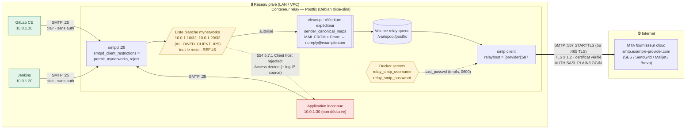
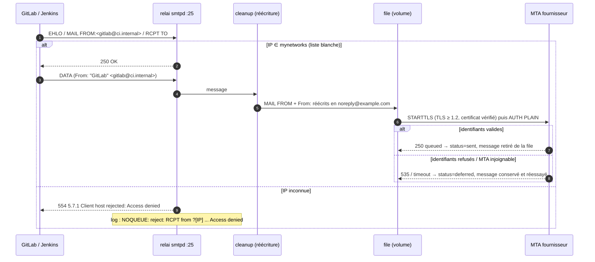
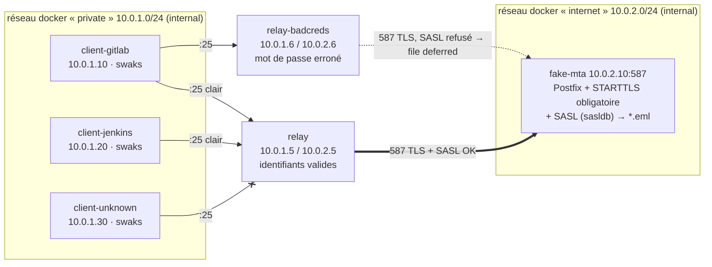

# Architecture du relai SMTP

## Vue d'ensemble

Le flux est **strictement sortant** : le relai n'a aucun domaine local
(`mydestination`, `relay_domains` vides, `local_transport = error`) et n'est
pas joignable depuis Internet.

## Flux

| # | Source → destination | Port | Protocole | Chiffrement | Authentification | Contrôle |
|---|----------------------|------|-----------|-------------|------------------|----------|
| 1 | GitLab (10.0.1.10) → relai | 25/tcp | SMTP | aucun (réseau privé) | aucune | IP en liste blanche `/32` |
| 2 | Jenkins (10.0.1.20) → relai | 25/tcp | SMTP | aucun (réseau privé) | aucune | IP en liste blanche `/32` |
| 3 | Application inconnue → relai | 25/tcp | SMTP | — | — | **rejet** `554 5.7.1` à RCPT TO + log |
| 4 | Relai → MTA fournisseur | 587/tcp (STARTTLS) ou 465/tcp (TLS implicite) | ESMTP | **TLS ≥ 1.2 obligatoire**, certificat vérifié (`secure`) | **SASL** user/password (Docker secrets) | `smtp_tls_security_level` |

## Traitement d'un message

## Environnement de test

La PKI de test (AC + certificat `fake-mta`) est générée par le faux MTA dans
le volume `test-pki`, monté en lecture seule dans le relai
(`RELAY_TLS_CA_FILE`) : le mode `secure` (vérification du certificat et du nom)
est donc réellement exercé.
