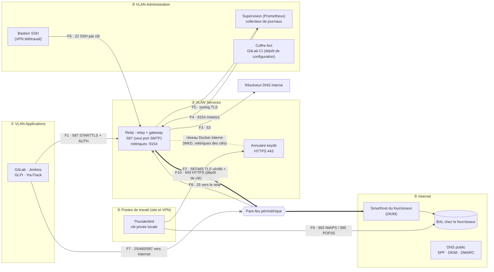
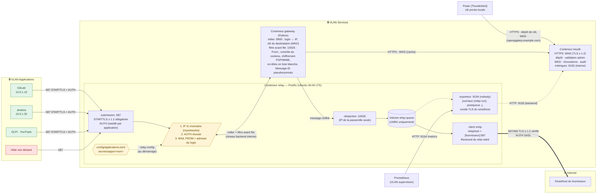
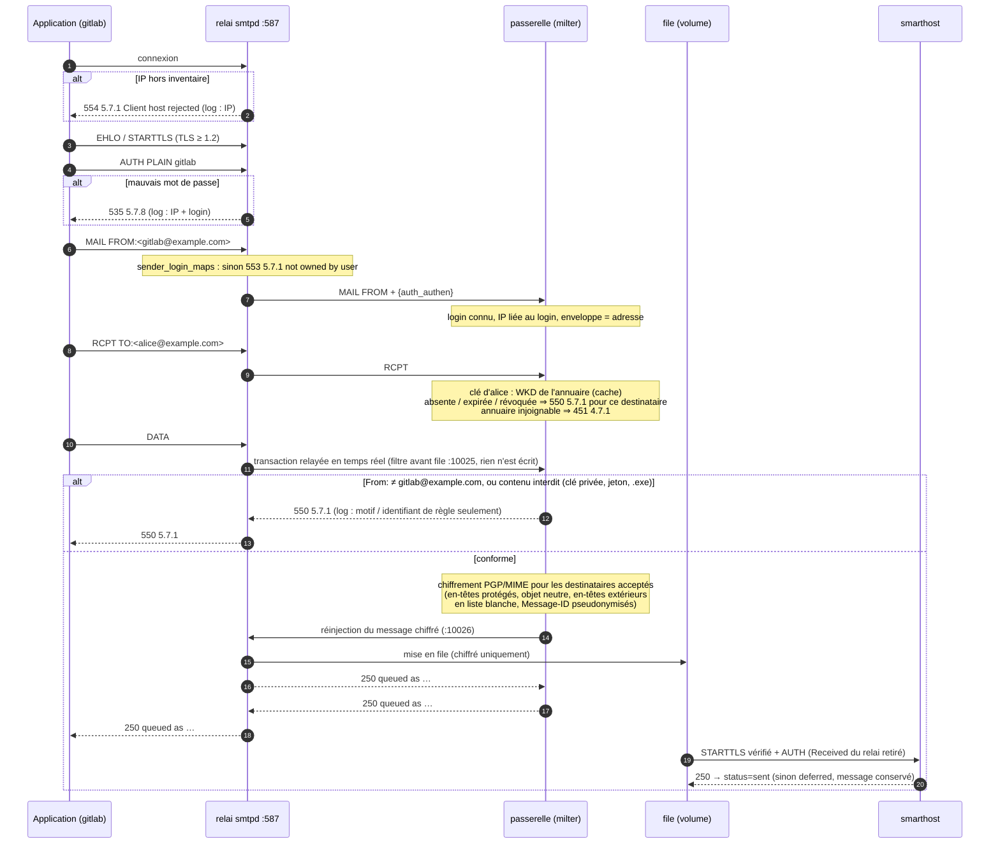
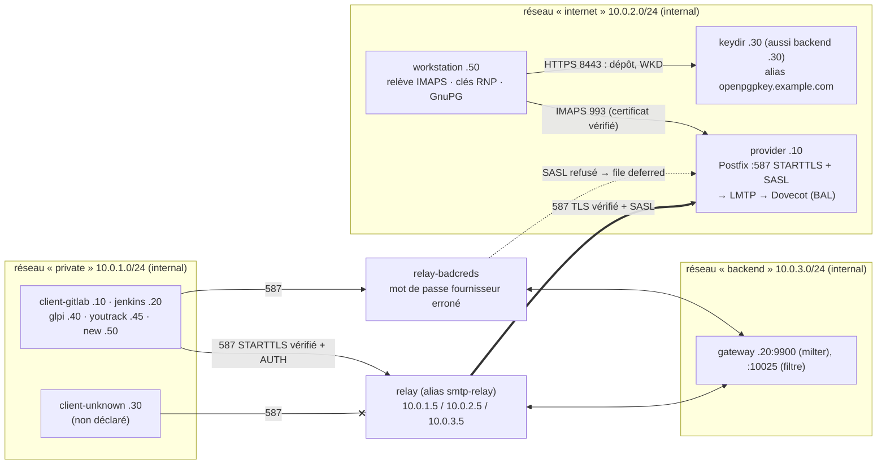
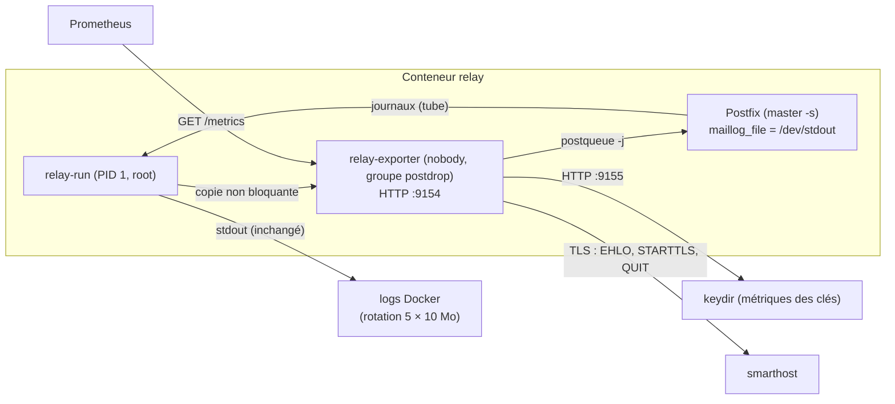

# Architecture du relai SMTP

> État : lots 0 à 4 et 6 à 8 du [plan d'implémentation](plan-implementation.md)
> réalisés (soumission 587 authentifiée, identité par application, annuaire de
> clés, chiffrement OpenPGP dans la passerelle avant la mise en file, nettoyage
> des en-têtes, contrôle du contenu, supervision, test après déploiement). Les
> quotas par application (lot 5) ne sont pas réalisés. Mise en production :
> [deploiement-production.md](deploiement-production.md).

## Zones et flux du PRD (F1 à F10)

| Flux | Source → destination | Port | Décision | Mise en œuvre | Vérification |
|------|----------------------|------|----------|---------------|--------------|
| F1 | VLAN Applications → relai | 587/tcp, STARTTLS + AUTH | autorisé | port publié sur `RELAY_BIND_ADDRESS` seulement ; TLS ≥ 1.2 obligatoire avant AUTH ; un login par application ; IP, login et adresse liés (Postfix + passerelle) | IT1.1 à IT1.10 |
| F2 | relai → smarthost | 587/tcp STARTTLS ou 465/tcp TLS | autorisé | `smtp_tls_security_level = secure` (chaîne et nom vérifiés), TLS ≥ 1.2, SASL ; message déjà chiffré | T5, T6, IT3.11, IT7.3 |
| F3 | relai → résolveur DNS interne | 53 | autorisé | résolveur de l'hôte (DNS intégré de Docker) | — |
| F4 | supervision → relai | 9154/tcp (`RELAY_METRICS_BIND_ADDRESS`) | autorisé | exporteur Prometheus, métadonnées seulement | IT7.1 à IT7.4 |
| F5 | relai → collecteur de journaux | syslog TLS | autorisé | journaux sur stdout, sans contenu ; export par le pilote de logs Docker ou un agent de l'hôte | IT7.5 |
| F6 | bastion → relai | 22/tcp, SSH par clé | autorisé | `sshd` de l'hôte (hors dépôt) | — |
| F7 | VLAN Applications → Internet | 25, 465, 587/tcp | **refusé et journalisé** | pare-feu périmétrique (hors dépôt) | recette R4 |
| F8 | toute source → relai | 25/tcp | **refusé** | aucun service sur le port 25 ; aucun port entrant depuis Internet | IT1.7 |
| F9 | postes → BAL du fournisseur | 993/tcp IMAPS ou 995/tcp POP3S | autorisé | Thunderbird ; seule sa clé privée déchiffre | IT3.1 (relève IMAPS vérifiée) |
| F10 | postes (site ou VPN) → annuaire | 443/tcp HTTPS | autorisé | `keydir` publié sur `KEYDIR_BIND_ADDRESS`, TLS ≥ 1.2, aucun port en clair ; clé publiée après validation de l'empreinte | IT2.1 à IT2.7 |

Flux internes à l'hôte du relai (réseau Docker `backend`, `internal`, non
routé) : relai ↔ passerelle (milter 9900, filtre avant file 10025,
réinjection 10026), passerelle → annuaire (WKD en HTTPS), exporteur →
annuaire (métriques 9155). Les règles de pare-feu à poser sont détaillées dans
le [guide de mise en production](deploiement-production.md#3-pare-feu).

## Vue d'ensemble

Le flux est **strictement sortant** : le relai n'a aucun domaine local
(`mydestination`, `relay_domains` vides, `local_transport = error`), n'écoute
que sur le port 587 et n'est pas joignable depuis Internet.

## Flux

| # | Source → destination | Port | Chiffrement | Authentification | Contrôles |
|---|----------------------|------|-------------|------------------|-----------|
| 1 | Application déclarée → relai | 587/tcp | **STARTTLS obligatoire**, TLS ≥ 1.2, certificat `smtp-relay` | **SASL** PLAIN/LOGIN, un identifiant par application, après STARTTLS uniquement | IP dans l'inventaire ; login ↔ IP ; `MAIL FROM` et `From:` = adresse du login |
| 2 | Hôte non déclaré → relai | 587/tcp | — | — | **refus** `554 5.7.1` dès la connexion + log |
| 3 | Relai ↔ passerelle | 9900/tcp (milter), 10025/tcp (filtre avant file) (réseau `backend` interne) | — (réseau Docker interne) | — | `milter_default_action = tempfail` : passerelle absente ⇒ erreur temporaire |
| 3a | Passerelle → relai (réinjection) | 10026/tcp sur l'adresse backend du relai | — (réseau Docker interne) | IP de la passerelle seule (`mynetworks`) | message déjà chiffré ; aucun milter ni filtre |
| 3b | Passerelle → annuaire | 8443/tcp (réseau `backend` interne) | HTTPS, TLS ≥ 1.2, certificat vérifié | — | WKD ; annuaire injoignable ⇒ `451 4.7.1` (échec fermé) |
| 4 | Relai → smarthost | 587/tcp (STARTTLS) ou 465/tcp | **TLS ≥ 1.2**, certificat vérifié (`secure`) | **SASL** (secrets) | `smtp_tls_security_level` |
| 5 | Poste → annuaire | 443/tcp (8443 dans le conteneur) | **HTTPS**, TLS ≥ 1.2, aucun port en clair | aucune (dépôt public) | clé publiée seulement après validation de l'empreinte par un administrateur ; révocation par certificat signé |
| 6 | Prometheus → relai (F4) | 9154/tcp (publié sur `RELAY_METRICS_BIND_ADDRESS`, `127.0.0.1` par défaut) | — (métadonnées) | — (filtrage réseau) | port à n'ouvrir qu'au serveur Prometheus |
| 6a | Relai (exporteur) → annuaire | 9155/tcp (réseau `backend` interne, non publié) | — (réseau Docker interne) | — | état des clés seulement (expiration, révocation), aucune donnée de clé |
| 6b | Relai (exporteur) → smarthost | comme le flux 4 | TLS ≥ 1.2, certificat vérifié | aucune (EHLO, STARTTLS, QUIT) | sonde périodique (`RELAY_METRICS_PROBE_INTERVAL`) : joignabilité et expiration du certificat |

## Traitement d'un message

## Environnement de test

La PKI de test (AC + certificats `provider`, `smtp-relay`, `keydir`) est
générée par le service one-shot `pki` dans le volume `test-pki`, monté en
lecture seule dans les autres conteneurs. Les clients vérifient le certificat
de `smtp-relay`, le relai vérifie celui du fournisseur (`secure`), le poste de
travail celui de l'IMAPS : toutes les vérifications TLS sont réellement exercées.

## Supervision et journaux

- **Aucun contenu dans les journaux** : Postfix, la passerelle et l'annuaire ne
  journalisent que des métadonnées (enveloppe, codes, identifiant de règle) ;
  IT7.5 le vérifie sur tous les conteneurs de la stack de test.
- **Aucun journal persistant dans les conteneurs** : tout part sur la sortie
  standard (rotation Docker) ; l'export syslog TLS (F5) se configure au niveau
  du démon Docker ou d'un collecteur, hors du dépôt.
- **L'exporteur ne bloque jamais le courrier** : `relay-run` lui donne une
  copie non bloquante des journaux (lignes perdues pour les métriques seulement
  en cas de retard) et le relance s'il s'arrête.
- **Test après déploiement** : `relay-smoke-test` (dans le conteneur du relai)
  soumet un message de contrôle de l'application locale `supervision`
  (`client_ips = ["127.0.0.1"]`) vers la BAL de supervision par le chemin réel,
  puis lit son résultat de livraison auprès de l'exporteur
  (`GET /delivery?qid=…`) : code 0 seulement si le smarthost l'a accepté.
