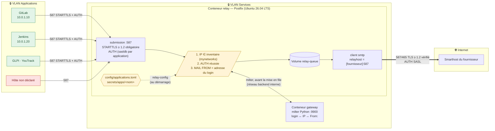
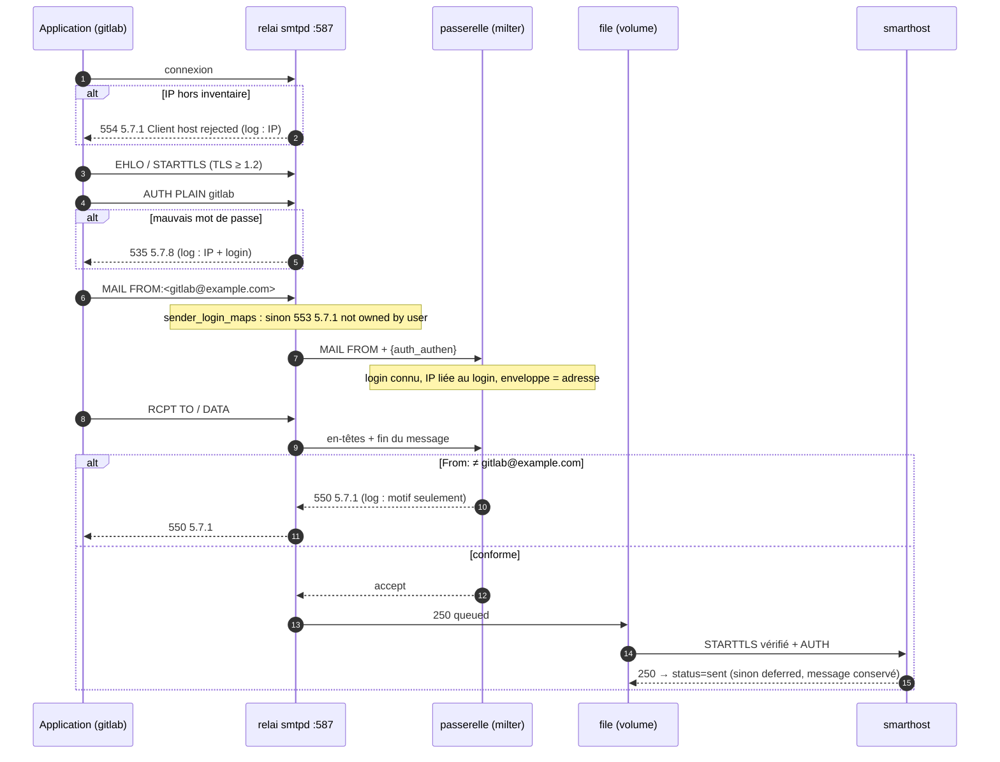
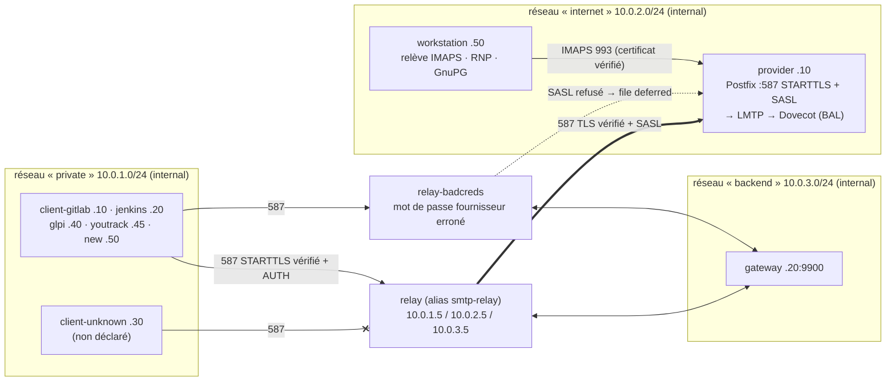

# Architecture du relai SMTP

> État actuel : lot 1 du [plan d'implémentation](plan-implementation.md)
> (soumission 587 authentifiée, identité par application, passerelle milter).
> Les lots suivants ajoutent l'annuaire de clés, le chiffrement OpenPGP, les
> quotas, le contrôle du contenu et la supervision.

## Vue d'ensemble

Le flux est **strictement sortant** : le relai n'a aucun domaine local
(`mydestination`, `relay_domains` vides, `local_transport = error`), n'écoute
que sur le port 587 et n'est pas joignable depuis Internet.

## Flux

| # | Source → destination | Port | Chiffrement | Authentification | Contrôles |
|---|----------------------|------|-------------|------------------|-----------|
| 1 | Application déclarée → relai | 587/tcp | **STARTTLS obligatoire**, TLS ≥ 1.2, certificat `smtp-relay` | **SASL** PLAIN/LOGIN, un identifiant par application, après STARTTLS uniquement | IP dans l'inventaire ; login ↔ IP ; `MAIL FROM` et `From:` = adresse du login |
| 2 | Hôte non déclaré → relai | 587/tcp | — | — | **refus** `554 5.7.1` dès la connexion + log |
| 3 | Relai ↔ passerelle | 9900/tcp (réseau `backend` interne) | — (réseau Docker interne) | — | `milter_default_action = tempfail` : passerelle absente ⇒ `451` |
| 4 | Relai → smarthost | 587/tcp (STARTTLS) ou 465/tcp | **TLS ≥ 1.2**, certificat vérifié (`secure`) | **SASL** (secrets) | `smtp_tls_security_level` |

## Traitement d'un message

## Environnement de test

La PKI de test (AC + certificats `provider`, `smtp-relay`, `keydir`) est
générée par le service one-shot `pki` dans le volume `test-pki`, monté en
lecture seule dans les autres conteneurs. Les clients vérifient le certificat
de `smtp-relay`, le relai vérifie celui du fournisseur (`secure`), le poste de
travail celui de l'IMAPS : toutes les vérifications TLS sont réellement exercées.
