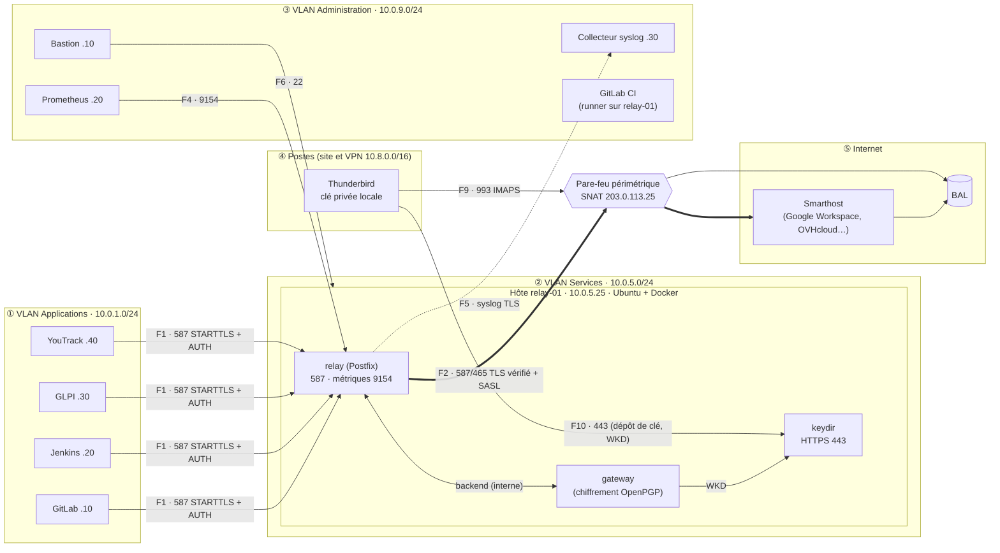

# Mise en production du relai SMTP chiffrant

Ce guide décrit la mise en production du relai sur site : réseau et pare-feu,
fournisseur (smarthost), DNS public, hôte, annuaire de clés et procédure de
vérification des clés, configuration de Thunderbird, recette et exploitation.
La référence technique (variables, métriques, dépannage détaillé) est
[README.md](README.md) ; l'architecture (5 zones, flux F1 à F10) est
[architecture.md](architecture.md).

> **Valeurs d'exemple** à adapter : domaine `example.com`, VLAN Applications
> `10.0.1.0/24` (GitLab `10.0.1.10`, Jenkins `10.0.1.20`, GLPI `10.0.1.30`,
> YouTrack `10.0.1.40`), VLAN Services `10.0.5.0/24` (hôte du relai
> `10.0.5.25`), VLAN Administration `10.0.9.0/24` (bastion `10.0.9.10`,
> supervision `10.0.9.20`, collecteur de journaux `10.0.9.30`), VPN télétravail
> `10.8.0.0/16`, IP publique de sortie `203.0.113.25`. Les menus des consoles
> des fournisseurs évoluent : vérifiez-les dans leur documentation au moment du
> déploiement.

## Sommaire

1. [Architecture de référence](#1-architecture-de-référence)
2. [Prérequis et décisions](#2-prérequis-et-décisions)
3. [Pare-feu](#3-pare-feu)
4. [Fournisseur (smarthost)](#4-fournisseur-smarthost)
5. [DNS](#5-dns)
6. [Hôte du relai](#6-hôte-du-relai)
7. [Installation](#7-installation)
8. [Annuaire de clés et vérification des clés](#8-annuaire-de-clés-et-vérification-des-clés)
9. [Thunderbird](#9-thunderbird)
10. [Raccorder les applications](#10-raccorder-les-applications)
11. [Recette](#11-recette)
12. [Exploitation](#12-exploitation)
13. [Dépannage propre aux fournisseurs](#13-dépannage-propre-aux-fournisseurs)

---

## 1. Architecture de référence



Parcours d'une notification :

1. Le destinataire crée sa paire de clés dans Thunderbird et dépose sa clé
   publique sur l'annuaire ; un administrateur vérifie l'empreinte avec lui,
   hors bande, puis la valide (section 8).
2. L'application soumet la notification au relai (F1) : STARTTLS, son login,
   depuis son IP, avec son adresse expéditrice.
3. La passerelle contrôle l'enveloppe, la clé de chaque destinataire (refus
   `550 5.7.1` sans clé valide, rien ne part en clair), le `From:` et le
   contenu, chiffre en PGP/MIME (objet neutre, en-têtes réduits) ; seul le
   message chiffré entre dans la file.
4. Le relai le transmet au smarthost en TLS vérifié avec authentification
   (F2) ; le fournisseur le signe (DKIM) et le dépose dans la BAL.
5. Thunderbird le relève (F9) et le déchiffre localement.

---

## 2. Prérequis et décisions

| Élément | Choix à faire / à fournir |
|---------|---------------------------|
| Domaine d'envoi | `sender_domain` de l'inventaire (identique au domaine principal, décision du PRD) ; une adresse par application (`gitlab@`, `jenkins@`…) |
| Fournisseur | hébergement dans l'UE, DKIM sur le domaine propre, contrat de sous-traitance (RGPD), coût au volume ; il doit accepter **plusieurs adresses expéditrices** pour un même compte SMTP (section 4) |
| Taille des messages | `MESSAGE_SIZE_LIMIT` : la version chiffrée grossit d'environ un tiers ; la limite du fournisseur doit être au moins égale à 1,5 × `MESSAGE_SIZE_LIMIT` |
| PKI interne | certificats de `smtp-relay.example.com` (applications) et de l'annuaire (`openpgpkey.example.com` + nom interne `keydir`) ; l'AC doit être reconnue par les applications, les postes et Thunderbird |
| BAL de supervision | une BAL (ex. `supervision@example.com`) pour le message de contrôle de `relay-smoke-test`, avec sa clé validée sur l'annuaire ; ses messages chiffrés sont lisibles par l'équipe d'exploitation |
| Durée de conservation des journaux | à fixer avec le DPO : rotation Docker, collecteur, `KEYDIR_AUDIT_RETENTION_DAYS`, rétention Prometheus |
| Séquestre des clés privées | hors du relai : sans sauvegarde de sa clé, un destinataire perd l'accès à ses anciens messages |

---

## 3. Pare-feu

### 3.1 Matrice de flux (PRD)

| Flux | Source | Destination | Port | Décision |
|------|--------|-------------|------|----------|
| F1 | VLAN Applications `10.0.1.10, .20, .30, .40` | relai `10.0.5.25` | 587/tcp | ✅ autoriser (IP des applications seulement) |
| F2 | relai `10.0.5.25` | smarthost (FQDN du fournisseur) | 587/tcp ou 465/tcp | ✅ autoriser, SNAT `203.0.113.25` |
| F3 | relai | résolveur DNS interne | 53/udp+tcp | ✅ autoriser |
| F4 | Prometheus `10.0.9.20` | relai | 9154/tcp | ✅ autoriser |
| F5 | relai | collecteur `10.0.9.30` | 6514/tcp (syslog TLS) | ✅ autoriser |
| F6 | bastion `10.0.9.10` (y compris VPN) | relai | 22/tcp | ✅ autoriser |
| F7 | VLAN Applications | Internet | 25, 465, 587/tcp | ⛔ refuser **et journaliser** |
| F8 | toute source | relai | 25/tcp | ⛔ refuser (aucun service n'y écoute) |
| F9 | postes du site | BAL du fournisseur | 993/tcp (ou 995/tcp) | ✅ autoriser |
| F10 | postes du site et VPN | annuaire `10.0.5.25` | 443/tcp | ✅ autoriser |
| — | Internet | site | * | ⛔ refuser : le relai n'est jamais joignable depuis Internet |
| — | relai | NTP interne ; miroirs Ubuntu, registre (maintenance) | 123/udp ; 443/tcp | ✅ autoriser (TLS exige une horloge juste) |

- **Pas de NAT entre le VLAN Applications et le relai** : la liaison login ↔ IP
  repose sur l'IP source réelle. Un proxy TCP ou un répartiteur en mode proxy
  masquerait toutes les applications derrière une seule IP.
- **Les IP des smarthosts changent** : utiliser des objets FQDN, ou ouvrir
  587/465 vers `any` depuis la seule IP du relai.
- SMTP ne traverse pas un proxy HTTP : F2 est une règle explicite.

Exemple de règles (pare-feu générique) :

```text
# VLAN Applications -> relai (routé, SANS NAT)
allow  src 10.0.1.10,10.0.1.20,10.0.1.30,10.0.1.40  dst 10.0.5.25  tcp/587   log
deny   src any                                      dst 10.0.5.25  tcp/25,587 log
# Postes -> annuaire de clés
allow  src 10.0.0.0/8,10.8.0.0/16                   dst 10.0.5.25  tcp/443
# Administration -> relai
allow  src 10.0.9.10                                dst 10.0.5.25  tcp/22
allow  src 10.0.9.20                                dst 10.0.5.25  tcp/9154
# Relai -> infrastructure et administration
allow  src 10.0.5.25  dst 10.0.0.53   udp,tcp/53
allow  src 10.0.5.25  dst 10.0.0.123  udp/123
allow  src 10.0.5.25  dst 10.0.9.30   tcp/6514
# Relai -> smarthost (SNAT 203.0.113.25)
allow  src 10.0.5.25  dst fqdn:smtp-relay.gmail.com  tcp/587  snat 203.0.113.25
# Toute autre sortie SMTP : refusée et journalisée (F7)
deny   src any        dst internet  tcp/25,465,587   log
deny   src internet   dst any       any              log
```

### 3.2 Pare-feu de l'hôte : seconde barrière

Les ports publiés par Docker contournent `INPUT` et `ufw` : le filtrage se fait
dans la chaîne **`DOCKER-USER`** (à persister, ou à traduire en nftables).

```bash
iptables -N RELAY-IN 2>/dev/null || iptables -F RELAY-IN
# 587 : applications de l'inventaire seulement
for ip in 10.0.1.10 10.0.1.20 10.0.1.30 10.0.1.40; do
    iptables -A RELAY-IN -p tcp -m conntrack --ctorigdstport 587 -s "$ip" -j RETURN
done
# 443 (annuaire) : postes du site et du VPN ; 9154 : Prometheus
iptables -A RELAY-IN -p tcp -m conntrack --ctorigdstport 443  -s 10.0.0.0/8  -j RETURN
iptables -A RELAY-IN -p tcp -m conntrack --ctorigdstport 443  -s 10.8.0.0/16 -j RETURN
iptables -A RELAY-IN -p tcp -m conntrack --ctorigdstport 9154 -s 10.0.9.20   -j RETURN
iptables -A RELAY-IN -j LOG --log-prefix "RELAY-IN-DROP " --log-level 4
iptables -A RELAY-IN -j DROP
iptables -C DOCKER-USER -i ens192 -m conntrack --ctstate NEW --ctdir ORIGINAL -j RELAY-IN 2>/dev/null \
  || iptables -I DOCKER-USER -i ens192 -m conntrack --ctstate NEW --ctdir ORIGINAL -j RELAY-IN
# SSH : bastion seulement
iptables -A INPUT -p tcp --dport 22 -s 10.0.9.10 -j ACCEPT
iptables -A INPUT -p tcp --dport 22 -j DROP
```

> La liste des IP des applications existe à trois endroits : le pare-feu
> périmétrique, `DOCKER-USER` et l'inventaire `config/applications.toml`
> (barrière applicative, source des refus journalisés). Toute modification
> touche les trois (section 12.2).

---

## 4. Fournisseur (smarthost)

Le relai ne réécrit plus l'expéditeur : chaque application émet avec **sa
propre adresse** (`gitlab@example.com`…), et le fournisseur doit les accepter
toutes pour le compte SMTP du relai.

| Critère | Google Workspace (`smtp-relay.gmail.com`) | OVHcloud Email |
|---------|-------------------------------------------|----------------|
| Hôte : port | `smtp-relay.gmail.com:587` (STARTTLS) ou 465 | `ssl0.ovh.net` (MX Plan), `proN.mail.ovh.net` (Email Pro), `exN.mail.ovh.net` (Exchange) : 587 ou 465 |
| Authentification | compte dédié (mot de passe d'application) et/ou IP `203.0.113.25` enregistrée | adresse complète de la boîte et son mot de passe |
| Adresses expéditrices | « Uniquement les adresses de mes domaines » : toutes les adresses de l'inventaire conviennent | adresse de la boîte authentifiée ; les autres adresses doivent être des **alias** de cette boîte ou avoir le droit « envoyer en tant que » |
| DKIM / SPF | console Google ; `include:_spf.google.com` | espace client ; `include:mx.ovh.com` |
| Taille maximale | 25 Mo | selon l'offre |

**Google Workspace** : créer un compte dédié (ex. `relay@example.com`),
activer la validation en deux étapes et générer un mot de passe d'application
(16 caractères, sans espaces). Dans *Console d'administration → Applications →
Google Workspace → Gmail → Routage → Service relais SMTP* : expéditeurs
« Uniquement les adresses de mes domaines », « Exiger l'authentification
SMTP », éventuellement l'IP `203.0.113.25/32`, et « Exiger le chiffrement TLS ».

**OVHcloud** : créer une boîte dédiée (ex. `relay@example.com`) avec un mot de
passe long réservé à cet usage, puis déclarer `gitlab@`, `jenkins@`, `glpi@`,
`youtrack@` et `supervision@` comme alias (ou délégations « envoyer en tant
que ») ; vérifier les quotas horaires de l'offre.

Paramètres du relai (`.env`) et secrets :

```dotenv
RELAY_HOST=smtp-relay.gmail.com        # ou ssl0.ovh.net, proN.mail.ovh.net…
RELAY_PORT=587                         # 465 : TLS implicite (wrappermode automatique)
RELAY_TLS_SECURITY_LEVEL=secure        # certificat et nom vérifiés
RELAY_HOSTNAME=relay.example.com       # EHLO : un FQDN du domaine
MESSAGE_SIZE_LIMIT=15000000            # 1,5 × 15 Mo ≤ limite du fournisseur
```

```bash
printf '%s' 'relay@example.com' > secrets/relay_smtp_username
printf '%s' 'abcdefghijklmnop'  > secrets/relay_smtp_password   # sans saut de ligne
```

Vérifier le nom du certificat présenté (le mode `secure` refuse tout écart) :
`openssl s_client -starttls smtp -connect smtp-relay.gmail.com:587 -servername smtp-relay.gmail.com </dev/null | openssl x509 -noout -subject -ext subjectAltName -enddate`.

---

## 5. DNS

**Zone publique** de `example.com` (délivrabilité) :

| Enregistrement | Valeur |
|----------------|--------|
| SPF (`example.com TXT`) | inclusion du seul smarthost, politique stricte : `v=spf1 include:_spf.google.com -all` (ou `include:mx.ovh.com`) |
| DKIM | clé publiée pour le domaine, signature par le smarthost (sélecteur fourni par la console du fournisseur) |
| DMARC (`_dmarc.example.com TXT`) | `v=DMARC1; p=none; rua=mailto:dmarc@example.com` au départ, puis `quarantine`, puis `reject` après analyse des rapports agrégés |
| Rebonds | domaine de rebond du fournisseur (CNAME) s'il en propose un |

L'IP du relai n'apparaît pas dans le SPF : ce sont les serveurs du fournisseur
qui remettent les messages. Un seul enregistrement SPF par domaine.

**Vue interne uniquement** (rien de ceci n'est publié sur Internet) :

| Nom | Type | Valeur | Usage |
|-----|------|--------|-------|
| `smtp-relay.example.com` | A | `10.0.5.25` | point d'entrée des applications (F1) |
| `openpgpkey.example.com` | A | `10.0.5.25` | annuaire : WKD (Thunderbird, GnuPG) et dépôt de clé (F10) ; résolu aussi par le VPN |

---

## 6. Hôte du relai

- Ubuntu Server 26.04 LTS minimal ; **disque chiffré** (LUKS) : le message
  existe en clair en mémoire le temps du traitement, et la file ne contient que
  du chiffré, mais les secrets et l'annuaire sont sur le disque.
- Docker Engine et le plugin Compose v2 depuis les dépôts officiels Docker ;
  `/etc/docker/daemon.json` : `{"userland-proxy": false, "live-restore": true}`
  (IP source réelle conservée, conteneurs maintenus pendant une mise à jour du
  démon).
- **Export des journaux (F5)** : les services journalisent en `json-file` avec
  rotation (5 × 10 Mo, fixé dans `docker-compose.yml`). Deux possibilités :
  - un agent sur l'hôte (Vector, Fluent Bit, rsyslog) qui lit
    `/var/lib/docker/containers/*/*-json.log` et les transmet en syslog TLS au
    collecteur ;
  - ou le pilote `syslog` de Docker, dans un fichier
    `/opt/smtp-relay/docker-compose.override.yml` (lu automatiquement par
    `docker compose`, propre à l'hôte, non versionné) :

    ```yaml
    x-syslog: &syslog
      driver: syslog
      options:
        syslog-address: "tcp+tls://10.0.9.30:6514"
        syslog-tls-ca-cert: /etc/docker/syslog-ca.pem
        tag: "{{.Name}}"
    services:
      relay: { logging: *syslog }
      gateway: { logging: *syslog }
      keydir: { logging: *syslog }
    ```

  Les journaux ne contiennent que des métadonnées (enveloppe, codes,
  identifiant de règle), jamais d'objet ni de corps.
- NTP actif (`systemd-timesyncd`), mises à jour de sécurité automatiques
  (`unattended-upgrades`), SSH par clé depuis le bastion seulement
  (`PasswordAuthentication no`, `PermitRootLogin no`).
- Pour le déploiement par la CI : un runner GitLab de type « shell » sur
  l'hôte, étiqueté `smtp-relay-production`, membre du groupe `docker`.

---

## 7. Installation

```bash
sudo install -d -o "$USER" -m 0750 /opt/smtp-relay
git clone <URL du dépôt> /opt/smtp-relay && cd /opt/smtp-relay
cp .env.example .env && chmod 600 .env
vi .env                                # valeurs <À PRÉCISER> : voir ci-dessous
```

Extrait de `.env` :

```dotenv
RELAY_BIND_ADDRESS=10.0.5.25           # 587 publié sur l'IP du VLAN Services seulement
KEYDIR_BIND_ADDRESS=10.0.5.25          # annuaire publié en 443
KEYDIR_DOMAINS=example.com
RELAY_METRICS_BIND_ADDRESS=10.0.5.25   # F4 (filtré à Prometheus par le pare-feu)
RELAY_SMOKE_TO=supervision@example.com # BAL du message de contrôle
GATEWAY_KEYDIR_CA_FILE=/etc/relay/ca-interne.pem   # AC interne (fichier config/ca-interne.pem)
TZ=Europe/Paris
# + bloc du fournisseur (section 4)
```

**AC interne** : la passerelle vérifie le certificat de l'annuaire (nom
`keydir`) ; déposer le certificat de l'AC interne (public) dans
`config/ca-interne.pem`, monté en lecture seule dans `/etc/relay/` de la
passerelle, et le désigner par `GATEWAY_KEYDIR_CA_FILE`.

**Inventaire** (`config/applications.toml`, versionné, revu en merge request) :
une table par application (login = nom de la table, adresse, IP), plus
l'application locale `supervision` (`client_ips = ["127.0.0.1"]`) utilisée par
`relay-smoke-test`. Voir [README.md, section 3](README.md#3-inventaire-variables-et-secrets).

**Secrets** (depuis le coffre-fort, jamais dans le dépôt ; voir
[secrets/README.md](../secrets/README.md)) :

| Fichier | Contenu |
|---------|---------|
| `secrets/relay_smtp_username`, `relay_smtp_password` | compte SMTP chez le fournisseur |
| `secrets/relay_tls_cert`, `relay_tls_key` | certificat de `smtp-relay.example.com` (AC interne) |
| `secrets/keydir_tls_cert`, `keydir_tls_key` | certificat de l'annuaire, SAN `openpgpkey.example.com` (un par domaine de `KEYDIR_DOMAINS`) **et** `keydir` (nom interne vérifié par la passerelle) : donc émis par l'AC interne |
| `secrets/gateway_hmac_key` | 48 caractères aléatoires (`openssl rand -base64 48`) |
| `secrets/apps/<application>` | un mot de passe par application, y compris `supervision` (`openssl rand -base64 32`) |

```bash
PYTHONPATH=common python3 -m relaycfg check --inventory config/applications.toml --secrets-dir secrets/apps
docker compose up -d --build --wait
docker compose ps                       # relay, gateway, keydir : (healthy)
docker compose logs relay | head -20    # résumé : inventaire, relayhost, TLS, métriques
```

Le message de contrôle ne peut partir qu'une fois la clé de la BAL de
supervision validée (section 8) ; ensuite :

```bash
docker compose exec relay relay-smoke-test
# OK : message de contrôle E16D9A4054 : accepté par le smarthost (status=sent)
```

**Déploiements suivants** : par la CI (`.gitlab-ci.yml`). Un tag `vX.Y.Z`
déclenche les tests puis, à la demande (job manuel `deploy`), le passage du
clone `/opt/smtp-relay` sur le tag, la reconstruction des images, le
remplacement des conteneurs (`--wait` : tous sains) et `relay-smoke-test`. Le
job `smoke-test` peut être planifié (*Build → Pipeline schedules*) pour un
contrôle quotidien de bout en bout ; son échec se voit dans GitLab. La file
d'attente reste dans le volume `relay-queue` d'un déploiement à l'autre.

---

## 8. Annuaire de clés et vérification des clés

L'annuaire publie les clés publiques **validées** des destinataires, en WKD
(`https://openpgpkey.example.com/.well-known/openpgpkey/example.com/hu/…`),
pour la passerelle et pour les clients OpenPGP.

### 8.1 Dépôt par le destinataire

Le destinataire exporte sa clé publique depuis Thunderbird (section 9) puis
la dépose :

```bash
curl --tlsv1.2 -H 'Content-Type: application/pgp-keys' --data-binary @alice-pub.asc \
     'https://openpgpkey.example.com/api/v1/keys?email=alice@example.com'
# {"email": "alice@example.com", "fingerprint": "3F0A…9C21", "state": "pending"}   (HTTP 202)
curl --tlsv1.2 https://openpgpkey.example.com/api/v1/keys/alice@example.com   # état
```

Refus motivés (`422`) : clé expirée ou révoquée, pas de sous-clé de
chiffrement, identité différente de l'adresse, domaine non géré, algorithme
faible (RSA < 3072). Les clés Curve25519 de Thunderbird sont acceptées.

### 8.2 Procédure de vérification (administrateur)

Une clé n'est jamais publiée sans cette vérification, qui protège contre le
dépôt d'une clé au nom d'un autre :

1. Lister les dépôts en attente (alerte `keydir_keys{state="pending"} > 0`) :
   `docker compose exec keydir keydir-admin list --state pending`.
2. Afficher le dépôt : `docker compose exec keydir keydir-admin show alice@example.com`.
3. **Contacter le destinataire par un autre canal** que le mail : téléphone
   (numéro de l'annuaire de l'entreprise, pas celui fourni dans une demande),
   en personne, ou visioconférence avec la caméra. Lui faire **lire**
   l'empreinte affichée dans Thunderbird (*Gestionnaire de clés OpenPGP →
   propriétés de la clé*) et la comparer caractère par caractère.
4. Si elle correspond : `docker compose exec keydir keydir-admin approve alice@example.com <EMPREINTE>`
   (refusé si l'empreinte diffère du dépôt). Sinon :
   `keydir-admin reject alice@example.com <EMPREINTE>`, et signaler l'incident.
5. La passerelle prend la clé en compte au plus tard après `GATEWAY_KEY_CACHE_TTL`
   (5 minutes) ; les mails adressés à alice sont dès lors chiffrés et acceptés.

Chaque étape est tracée dans le journal d'audit (`keydir-admin audit`),
conservé `KEYDIR_AUDIT_RETENTION_DAYS` jours.

### 8.3 Cycle de vie

| Événement | Procédure |
|-----------|-----------|
| Expiration proche (alerte `keydir_keys_expiring_soon > 0`, seuil `KEYDIR_EXPIRY_WARNING_DAYS`) | prévenir le destinataire : prolonger la clé dans Thunderbird (nouvelle date d'expiration), la redéposer et la faire revalider ; une clé expirée entraîne le refus des mails qui lui sont destinés |
| Nouvelle clé (poste changé, clé perdue) | dépôt de la nouvelle clé, vérification (8.2) ; l'ancienne reste servie jusqu'à la validation de la nouvelle |
| Clé compromise ou perdue | révocation immédiate : `keydir-admin revoke <adresse>` après vérification de l'identité du demandeur (ou dépôt par le destinataire de son certificat de révocation, appliqué sans validation) ; les mails sont refusés jusqu'à la validation d'une nouvelle clé |
| Départ d'un collaborateur | `keydir-admin revoke`, puis `keydir-admin remove` (effacement, RGPD) |

> Perte de clé privée : sans sauvegarde ou séquestre, les messages déjà reçus
> restent illisibles. Faire sauvegarder la clé privée (export protégé par phrase
> de passe) dans un emplacement sûr, selon la politique de l'entreprise.

---

## 9. Thunderbird

À faire sur chaque poste destinataire (Thunderbird 115 ou plus récent, sans
module complémentaire) :

1. **Faire confiance à l'AC interne** (annuaire en HTTPS) : *Paramètres → Vie
   privée et sécurité → Certificats → Gérer les certificats → Autorités →
   Importer* ; ou, si l'AC est dans le magasin du système, mettre
   `security.enterprise_roots.enabled` à `true` (*Éditeur de configuration*).
2. **Protéger le profil** : *Vie privée et sécurité → Utiliser un mot de passe
   principal* (il protège la clé privée OpenPGP stockée dans le profil).
3. **Créer la clé** : *Paramètres des comptes → [compte] → Chiffrement de bout
   en bout → Ajouter une clé → Créer une nouvelle clé OpenPGP* : identité =
   l'adresse de la BAL, type **ECC (Curve25519)** (ou RSA 3072 et plus),
   expiration 2 ou 3 ans.
4. **Exporter la clé publique** : *Gestionnaire de clés OpenPGP* → sélectionner
   la clé → *Fichier → Exporter des clés publiques dans un fichier*
   (`alice-pub.asc`). Ne jamais exporter la clé secrète pour ce dépôt.
5. **Déposer la clé** (section 8.1), puis **communiquer l'empreinte** à
   l'administrateur lors de son appel de vérification (section 8.2).
6. **Relève** : compte IMAP en SSL/TLS sur le port 993 (F9), certificat du
   fournisseur vérifié. Les messages arrivent avec l'objet neutre (« Message
   chiffré ») ; à l'ouverture, Thunderbird les déchiffre et affiche l'objet réel
   et les en-têtes protégés.
7. **Sauvegarde** : *Gestionnaire de clés OpenPGP → Fichier → Sauvegarder les
   clés secrètes dans un fichier* (protégé par une phrase de passe), à conserver
   selon la politique de séquestre.

Pour envoyer eux-mêmes des messages chiffrés aux autres destinataires,
Thunderbird peut découvrir leurs clés par WKD (*Gestionnaire de clés → Serveur
de clés → Découvrir des clés en ligne*), servi par le même annuaire.

---

## 10. Raccorder les applications

Chaque application parle à **`smtp-relay.example.com:587` en STARTTLS**, avec
son login et son mot de passe (`secrets/apps/<nom>`), et son adresse
expéditrice de l'inventaire, en faisant confiance à l'AC interne. Le détail
(GitLab `gitlab.rb`, Jenkins Mailer et Email Extension, GLPI, YouTrack) est
dans [README.md, section 7](README.md#7-configuration-des-applications).

Les destinataires des notifications doivent avoir une clé validée : une
notification à une adresse sans clé est refusée (`550 5.7.1 No valid OpenPGP
key`) et l'application journalise l'erreur. Publier les clés des destinataires
**avant** de basculer une application sur le relai.

---

## 11. Recette

| # | Test | Méthode | Résultat attendu |
|---|------|---------|------------------|
| R1 | Bout en bout | `docker compose exec relay relay-smoke-test` | code 0, `accepté par le smarthost (status=sent)` ; message chiffré dans la BAL de supervision, lisible dans Thunderbird |
| R2 | Chaque application | test d'envoi depuis l'application (GitLab : `Notify.test_email`) vers un destinataire dont la clé est validée | reçu chiffré, objet neutre à l'extérieur, objet réel une fois déchiffré |
| R3 | Destinataire sans clé | envoi vers une adresse sans clé validée | refus `550 5.7.1 No valid OpenPGP key`, rien de livré |
| R4 | Sortie SMTP directe (F7) | depuis un serveur du VLAN Applications : `nc -vz smtp-relay.gmail.com 587` | bloqué et journalisé par le pare-feu |
| R5 | Port 25 et Internet (F8) | `nc -vz 10.0.5.25 25` ; depuis l'extérieur : `nc -vz 203.0.113.25 587` | aucune réponse |
| R6 | IP non déclarée | swaks depuis une machine hors inventaire (pare-feu ouvert pour le test) | `554 5.7.1 Client host rejected`, ligne `NOQUEUE: reject` dans les logs |
| R7 | Usurpation | login `jenkins` avec `MAIL FROM:<gitlab@example.com>` | `553 5.7.1 … not owned by user` |
| R8 | Authentification au fournisseur | `docker compose logs relay \| grep -E 'Verified TLS\|status=sent'` | `Verified TLS connection established … TLSv1.3`, `status=sent` |
| R9 | Délivrabilité | message reçu, en-têtes (Gmail : *Afficher l'original*) | SPF, DKIM (d=example.com) et DMARC : PASS |
| R10 | Persistance de la file | couper F2, lancer `relay-smoke-test` (code 1, `livraison différée`), `docker compose restart relay`, rouvrir F2, `postqueue -f` | message conservé puis livré ; aucune donnée en clair dans la file |
| R11 | Supervision | Prometheus scrape `10.0.5.25:9154` ; couper F2 | `relay_smarthost_up 0`, alerte d'âge de file ; certificat du smarthost : `relay_smarthost_certificate_expiry_timestamp_seconds` |
| R12 | Journaux | collecteur syslog | lignes reçues (F5), sans objet ni corps de message |

Les tests automatisés du dépôt (`tests/run-tests.sh`) valident la logique sur
une stack simulée ; cette recette valide l'intégration réelle : réseau,
pare-feu, fournisseur, DNS, postes.

---

## 12. Exploitation

### 12.1 Supervision

Prometheus scrape `http://10.0.5.25:9154/metrics` (métriques du relai et de
l'annuaire, détail et alertes dans [README.md](README.md#supervision-exporteur-prometheus)) :

| Indicateur du PRD | Alerte |
|-------------------|--------|
| Taille de la file, âge du plus ancien message | `relay_queue_oldest_message_age_seconds > 3600` |
| Différés et rejetés par application | `increase(relay_deferrals_total[1h]) > 0`, `increase(relay_rejects_total[1h])` par `app` |
| Refus faute de clé, par destinataire | `increase(relay_nokey_rejects_total[1d]) > 0` (clé à publier ou à renouveler) |
| Clés proches de l'expiration ou révoquées | `keydir_keys_expiring_soon > 0`, `keydir_keys_revoked > 0`, `keydir_keys{state="pending"} > 0` |
| Échecs d'authentification | `increase(relay_auth_failures_total[15m]) > 10` |
| Joignabilité du smarthost, expiration des certificats | `relay_smarthost_up == 0`, `relay_smarthost_certificate_expiry_timestamp_seconds - time() < 14*86400` |
| Bout en bout | échec du job planifié `smoke-test` |
| Rapports DMARC agrégés | boîte `rua` (outil d'analyse DMARC) |

Rappel (décision du PRD) : les alertes envoyées par mail passent par le relai
qu'elles surveillent ; aucune voie de secours n'est prévue, d'où l'intérêt des
alertes Prometheus et de l'état des pipelines GitLab.

### 12.2 Ajouter ou retirer une application

1. Merge request sur `config/applications.toml` : table `[applications.<nom>]`
   (adresse, IP) ; la CI valide l'inventaire ; revue par une seconde personne.
2. Mot de passe dans le coffre, puis `secrets/apps/<nom>` sur l'hôte (`0600`).
3. Pare-feu périmétrique et `DOCKER-USER` : ouvrir 587 pour l'IP (ou retirer).
4. Fournisseur : adresse autorisée comme expéditrice (alias chez OVHcloud).
5. Déploiement (tag + job `deploy`, ou `docker compose up -d`) : la base SASL
   est reconstruite ; une application retirée perd immédiatement son accès.
6. Test d'envoi depuis l'application.

### 12.3 Rotation des secrets

| Secret | Procédure | Fréquence |
|--------|-----------|-----------|
| Mot de passe d'une application | nouveau mot de passe dans le coffre et `secrets/apps/<nom>`, `docker compose restart relay`, mise à jour dans l'application (les envois échouent temporairement entre les deux, puis l'application réessaie) | 12 mois, et à tout départ ou soupçon de fuite |
| Compte du fournisseur | nouveau mot de passe d'application (Google) ou de boîte (OVHcloud), `secrets/relay_smtp_password`, `docker compose up -d`, `relay-smoke-test`, puis révocation de l'ancien | 6 à 12 mois |
| Certificats `smtp-relay` et annuaire | nouveaux fichiers `secrets/relay_tls_*`, `secrets/keydir_tls_*`, `docker compose up -d` | avant expiration |
| `gateway_hmac_key` | à ne changer qu'en cas de fuite : les fils de discussion en cours sont coupés (identifiants pseudonymisés différents) | — |

### 12.4 Mises à jour et sauvegarde

- **Mises à jour** : mensuelles et à chaque alerte de sécurité Ubuntu (Postfix,
  OpenSSL, GnuPG, Python) : nouveau tag daté `UBUNTU_TAG`, merge request, tag,
  job `deploy`. La reconstruction rafraîchit aussi les autorités de confiance.
- **Sauvegarde** : configuration dans Git, secrets dans le coffre ; le volume
  `keydir-data` (clés validées et journal d'audit) est à sauvegarder ; la file
  (`relay-queue`) est couverte par l'instantané de la VM. Ne jamais faire
  `docker compose down -v` avec des messages en file.
- **Reprise** : réinstaller (section 7) avec la même IP, restaurer
  `keydir-data`, puis `relay-smoke-test`.

---

## 13. Dépannage propre aux fournisseurs

| Message (logs du relai ou `relay-smoke-test`) | Cause | Correction |
|-----------------------------------------------|-------|------------|
| `livraison différée (motif : auth)`, `535-5.7.8 Username and Password not accepted` (Google) | mot de passe d'application erroné ou révoqué | régénérer, mettre à jour le secret, `docker compose up -d`, `postqueue -f` |
| `550-5.7.1 Invalid credentials for relay [203.0.113.25]` (Google) | IP non enregistrée, ou adresse hors des domaines Workspace | vérifier *Service relais SMTP* et `sender_domain` |
| refus « sender address rejected / not owned by user » (OVHcloud) | adresse d'application qui n'est pas un alias de la boîte authentifiée | déclarer l'alias ou le droit « envoyer en tant que » |
| `421-4.7.0 Try again later, closing connection. (EHLO)` (Google) | nom EHLO invalide | `RELAY_HOSTNAME=relay.example.com` |
| `550 5.4.5 Daily user sending limit exceeded` (Google), refus temporaires répétés (OVHcloud) | quota du fournisseur | lisser les envois, offre supérieure |
| `livraison différée (motif : tls)`, `Server certificate not verified` | `RELAY_HOST` différent du nom du certificat, ou AC absente | nom exact du fournisseur ; `RELAY_TLS_CA_FILE` |
| `livraison différée (motif : connection)` ou `dns` | F2 fermé, SNAT absent, DNS | pare-feu externe, route par défaut, résolveur |
| `552 5.3.4 Message size exceeds fixed limit` (fournisseur) | message chiffré plus gros que la limite du fournisseur | baisser `MESSAGE_SIZE_LIMIT` (≤ limite / 1,5) |

Les autres symptômes (inventaire, certificats, clés, passerelle) sont décrits
dans [README.md, section 10](README.md#10-dépannage).
