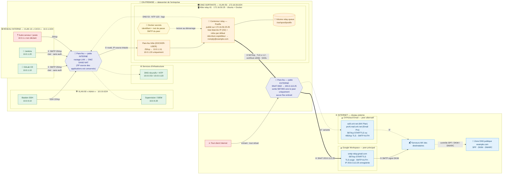
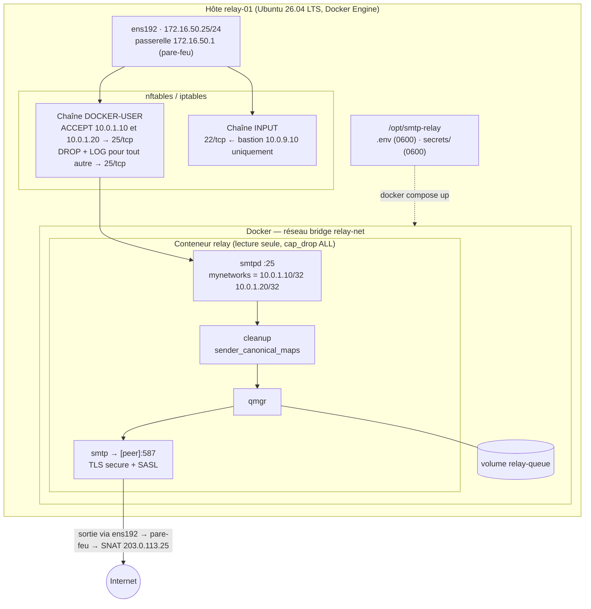
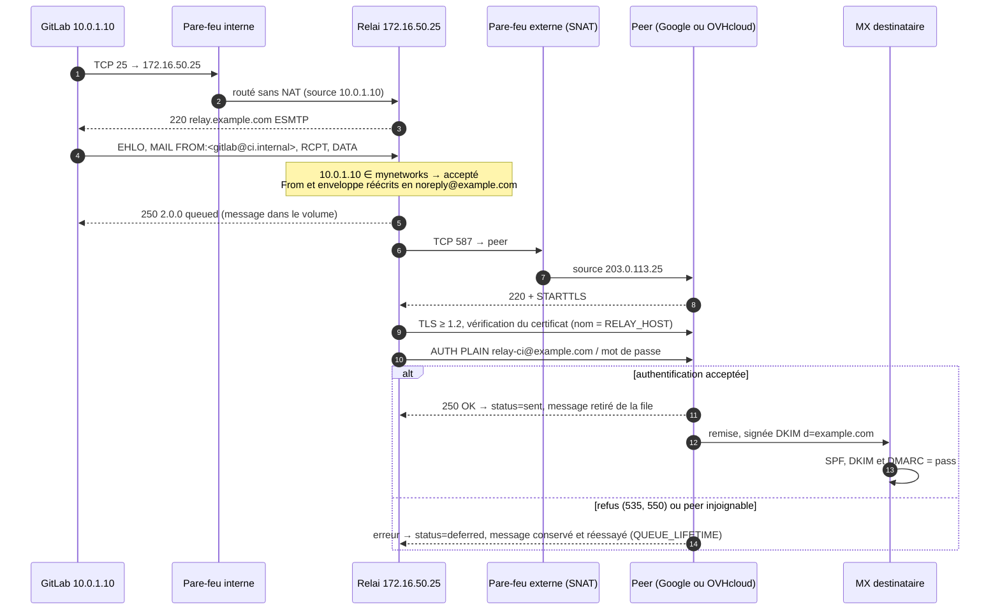

# Mise en œuvre en production : relai on-premise vers Google Workspace ou OVHcloud

Ce guide décrit le déploiement du relai SMTP en production dans l'architecture suivante :

- **GitLab CE, Jenkins et le relai sont hébergés on-premise**, dans le datacenter de l'entreprise ;
- le relai est le **seul** composant autorisé à sortir sur Internet, depuis une DMZ ;
- il transmet les notifications à un **fournisseur cloud (peer)** :
  - **Google Workspace**, service relais SMTP `smtp-relay.gmail.com` : peer recommandé ;
  - **OVHcloud Email** (MX Plan, Email Pro ou Exchange) : peer alternatif.

> Toutes les adresses, tous les noms et tous les comptes cités ici sont des **exemples** à
> adapter : `example.com`, `10.0.1.0/24`, `172.16.50.0/24`, `203.0.113.25`
> (plage de documentation), `relay-ci@example.com`.
> Les noms de menus des consoles Google et OVHcloud ainsi que les quotas évoluent :
> vérifiez-les dans la documentation officielle du fournisseur au moment du déploiement.

## Sommaire

1. [Architecture de référence](#1-architecture-de-référence)
2. [Plan d'adressage et matrice de flux](#2-plan-dadressage-et-matrice-de-flux)
3. [Choisir le peer : Google ou OVHcloud](#3-choisir-le-peer--google-workspace-ou-ovhcloud)
4. [Préparer le peer Google Workspace](#4-préparer-le-peer-google-workspace)
5. [Préparer le peer OVHcloud Email](#5-préparer-le-peer-ovhcloud-email)
6. [DNS public : SPF, DKIM et DMARC](#6-dns-public--spf-dkim-dmarc)
7. [Préparer le réseau on-premise](#7-préparer-le-réseau-on-premise)
8. [Installer le relai](#8-installer-le-relai)
9. [Raccorder GitLab et Jenkins](#9-raccorder-gitlab-et-jenkins)
10. [Recette avant la mise en service](#10-recette-avant-mise-en-service)
11. [Exploitation courante](#11-exploitation-courante)
12. [Dépannage propre à chaque peer](#12-dépannage-spécifique-aux-peers)
13. [Évolutions possibles](#13-évolutions)

---

## 1. Architecture de référence

### 1.1 Vue d'ensemble : zones réseau, services, relai et peers



**Lecture du schéma**

| Étape | Description |
|-------|-------------|
| ① | Les applications parlent au relai en SMTP **clair et sans authentification** sur le port 25 (exigence du réseau interne). |
| ② | Le pare-feu **route** le trafic du LAN vers la DMZ **sans le traduire (pas de NAT)**. C'est indispensable : la liste blanche de Postfix repose sur l'IP source réelle (`10.0.1.10`, `10.0.1.20`). Une IP non déclarée est bloquée par le pare-feu et, en défense en profondeur, rejetée par Postfix avec `554 5.7.1`. |
| ③ | Le relai réécrit l'expéditeur, met le message en file d'attente dans le volume, puis l'émet vers le peer en **TLS ≥ 1.2** avec vérification du certificat et authentification **SASL**. |
| ④ | Le pare-feu externe traduit la DMZ vers **une IP publique fixe** (`203.0.113.25`), que Google peut enregistrer. Aucun flux entrant n'est autorisé : le relai n'est **jamais** joignable depuis Internet. |
| ⑤ | Le peer signe le message en DKIM et le remet aux MX des destinataires, qui le vérifient avec la zone DNS publique. |

### 1.2 Zoom sur l'hôte du relai



### 1.3 Parcours d'un message



---

## 2. Plan d'adressage et matrice de flux

### 2.1 Adressage (exemple)

| Zone | VLAN / sous-réseau | Élément | Adresse |
|------|--------------------|---------|---------|
| Interne CI/CD | VLAN 10 · `10.0.1.0/24` | GitLab CE | `10.0.1.10` |
| | | Jenkins | `10.0.1.20` |
| Administration | VLAN 90 · `10.0.9.0/24` | Bastion SSH | `10.0.9.10` |
| | | Supervision / SIEM | `10.0.9.20` |
| Infrastructure | `10.0.0.0/24` | DNS récursif / NTP | `10.0.0.53` / `10.0.0.123` |
| DMZ sortante | VLAN 50 · `172.16.50.0/24` | passerelle (pare-feu) | `172.16.50.1` |
| | | **relay-01** | **`172.16.50.25`** |
| Externe | — | IP publique de sortie (SNAT) | **`203.0.113.25`** |
| DNS interne | — | `relay.example.com` (vue interne uniquement) | A `172.16.50.25` |

> Le nom `relay.example.com` ne doit exister que dans la **vue DNS interne**. Il ne
> doit pas être publié dans la zone publique, puisque le relai ne reçoit rien depuis Internet.

### 2.2 Matrice de flux à ouvrir sur le pare-feu

| # | Source | Destination | Port | Protocole | Chiffrement / auth | NAT | Action |
|---|--------|-------------|------|-----------|--------------------|-----|--------|
| F1 | `10.0.1.10` (GitLab) | `172.16.50.25` | 25/tcp | SMTP | clair, sans auth | **aucun** | ✅ autoriser |
| F2 | `10.0.1.20` (Jenkins) | `172.16.50.25` | 25/tcp | SMTP | clair, sans auth | **aucun** | ✅ autoriser |
| F3 | toute autre source | `172.16.50.25` | 25/tcp | SMTP | — | — | ⛔ refuser + journaliser |
| F4 | `172.16.50.25` | peer : `smtp-relay.gmail.com` **ou** `ssl0.ovh.net` / `proN.mail.ovh.net` | 587/tcp (et 465/tcp pour OVH) | ESMTP | **TLS ≥ 1.2 + SASL** | SNAT `203.0.113.25` | ✅ autoriser |
| F5 | `172.16.50.25` | `10.0.0.53` | 53/udp+tcp | DNS | — | aucun | ✅ autoriser |
| F6 | `172.16.50.25` | `10.0.0.123` | 123/udp | NTP | — | aucun | ✅ autoriser (TLS exige une horloge juste) |
| F7 | `10.0.9.10` (bastion) | `172.16.50.25` | 22/tcp | SSH | clé SSH | aucun | ✅ autoriser |
| F8 | `172.16.50.25` | `10.0.9.20` | 514/tcp ou 6514/tcp | syslog | TLS recommandé | aucun | ✅ optionnel (centralisation des logs) |
| F9 | `172.16.50.25` | miroir Ubuntu / registre / proxy | 443/tcp | HTTPS | TLS | SNAT ou proxy | ✅ maintenance (build, mises à jour) |
| F10 | Internet | `172.16.50.25` ou `203.0.113.25` | * | * | — | — | ⛔ **refuser** (aucune redirection de port) |
| F11 | `172.16.50.25` | Internet | 25/tcp | SMTP | — | — | ⛔ refuser (aucun envoi direct aux MX) |
| F12 | LAN `10.0.0.0/8` | Internet | 25, 465, 587/tcp | SMTP | — | — | ⛔ refuser : les applications passent **obligatoirement** par le relai |
| F13 | `172.16.50.25` | LAN `10.0.0.0/8` | * | * | — | — | ⛔ refuser, sauf F5, F6 et F8 |

Points d'attention :

- **Pas de SNAT ni de proxy entre le LAN et la DMZ** pour F1 et F2. Si le pare-feu masquait la
  source (masquerade, proxy SMTP, répartiteur de charge en mode proxy), Postfix ne verrait qu'une
  seule IP, celle du pare-feu. Il faudrait alors la déclarer, ce qui ouvrirait le relai à tout le LAN.
- **Les adresses IP des peers changent** (pools anycast de Google, fermes OVHcloud). Pour F4,
  utilisez des **objets FQDN** si le pare-feu les gère. À défaut, ouvrez 587/tcp (et 465/tcp) vers
  `any` **depuis la seule IP du relai**.
- Si les sorties de l'entreprise passent par un proxy HTTP, rappelez-vous que **SMTP ne traverse pas un proxy
  HTTP** : F4 doit être une règle de pare-feu explicite.

---

## 3. Choisir le peer : Google Workspace ou OVHcloud

| Critère | Google Workspace (`smtp-relay.gmail.com`) | OVHcloud Email (MX Plan / Email Pro / Exchange) |
|---------|------------------------------------------|-----------------------------------------------|
| Prérequis | domaine géré dans Google Workspace | domaine avec une offre email OVHcloud |
| Hôte : port | `smtp-relay.gmail.com:587` (STARTTLS) ; 465 possible | MX Plan : `ssl0.ovh.net:587` ou `:465` ; Email Pro : `proN.mail.ovh.net:587` ; Exchange : `exN.mail.ovh.net:587` (le nom exact figure dans l'espace client) |
| Authentification | SMTP AUTH avec un compte Workspace dédié (mot de passe d'application) **et/ou** IP publique enregistrée | SMTP AUTH : adresse complète de la boîte et son mot de passe |
| Expéditeurs autorisés | réglable : « adresses de mes domaines » | **l'adresse de la boîte authentifiée** (ou un alias, ou un droit « envoyer en tant que ») |
| DKIM | signé par Google après activation dans la console | activable dans l'espace client OVHcloud |
| SPF | `include:_spf.google.com` | `include:mx.ovh.com` |
| Quotas | élevés (de l'ordre de 10 000 destinataires par jour et par utilisateur pour le service relais) | plus serrés, souvent comptés par heure et par boîte |
| Taille maximale | 25 Mo | dépend de l'offre |
| Recommandé pour | volume CI/CD important, domaine déjà sous Workspace | petit volume, domaine et messagerie déjà chez OVHcloud |

Le relai est identique dans les deux cas : **seules quelques variables changent**
(`RELAY_HOST`, `RELAY_PORT`, les secrets et `SENDER_ADDRESS`). On peut basculer d'un peer à
l'autre en modifiant ces variables, puis en exécutant `docker compose up -d` ; les mails en file sont conservés.

---

## 4. Préparer le peer Google Workspace

### 4.1 Compte d'authentification dédié

1. Créez un utilisateur Workspace dédié, par exemple `relay-ci@example.com`. Il occupe une licence.
   Ne réutilisez **pas** un compte nominatif.
2. Activez la **validation en deux étapes** sur ce compte, puis générez un **mot de passe
   d'application** (*Compte Google → Sécurité → Mots de passe des applications*). La valeur
   affichée fait 16 caractères : notez-la **sans les espaces**. C'est elle qui ira dans le secret
   `relay_smtp_password`.
3. Restreignez l'usage du compte : pas d'accès aux services inutiles, et une unité organisationnelle dédiée.

### 4.2 Service relais SMTP (console d'administration)

*Console d'administration → Applications → Google Workspace → Gmail → Routage → **Service
relais SMTP** → Configurer.*

| Réglage | Valeur recommandée | Pourquoi |
|---------|--------------------|----------|
| Description | `relai-ci-onprem` | traçabilité |
| Expéditeurs autorisés | **Uniquement les adresses de mes domaines** | le relai réécrit tout en `noreply@example.com`, qui appartient au domaine |
| Authentification | ☑ **Exiger l'authentification SMTP** | lie l'usage à un compte identifié |
| | ☑ Accepter uniquement les e-mails provenant des adresses IP spécifiées : `203.0.113.25/32` | n'accepte que l'IP publique de sortie de l'entreprise |
| Chiffrement | ☑ **Exiger le chiffrement TLS** | cohérent avec `smtp_tls_security_level = secure` |

> Vérifiez dans la documentation Google comment se combinent les deux options
> d'authentification lorsqu'elles sont cochées ensemble. La propagation d'un
> changement dans la console peut prendre de quelques minutes à plusieurs heures.

### 4.3 Paramètres du relai (`.env`)

```dotenv
ALLOWED_CLIENT_IPS=10.0.1.10,10.0.1.20
RELAY_BIND_ADDRESS=172.16.50.25
RELAY_PUBLISHED_PORT=25

SENDER_DOMAIN=example.com
SENDER_ADDRESS=noreply@example.com
SENDER_REWRITE_MODE=always
# EHLO annoncé à Google : un FQDN du domaine (Google refuse un EHLO invalide ou "localhost")
RELAY_HOSTNAME=relay.example.com

RELAY_HOST=smtp-relay.gmail.com
RELAY_PORT=587
RELAY_TLS_SECURITY_LEVEL=secure
# Limite Google : 25 Mo encodage compris → garder une marge
MESSAGE_SIZE_LIMIT=20000000
TZ=Europe/Paris
```

Secrets :

```bash
printf '%s' 'relay-ci@example.com'  > secrets/relay_smtp_username
printf '%s' 'abcdefghijklmnop'      > secrets/relay_smtp_password   # mot de passe d'application, sans espaces
chmod 600 secrets/relay_smtp_*
```

---

## 5. Préparer le peer OVHcloud Email

### 5.1 Boîte d'émission dédiée

1. Dans l'**espace client OVHcloud** (*Web Cloud → Emails* pour MX Plan, *Email Pro* ou
   *Microsoft → Exchange*), créez une boîte dédiée, idéalement **`noreply@example.com`**.
   OVHcloud n'accepte en principe que l'adresse de la boîte authentifiée comme expéditeur : il est
   donc plus simple que le compte d'authentification **soit** l'adresse d'expédition.
2. Choisissez un mot de passe long et aléatoire, réservé à cet usage.
3. Relevez le **serveur SMTP exact** affiché pour l'offre : `ssl0.ovh.net` (MX Plan),
   `proN.mail.ovh.net` (Email Pro) ou `exN.mail.ovh.net` (Exchange).
4. Activez **DKIM** pour le domaine dans l'espace client (voir la section 6).
5. Consultez les **quotas d'envoi** de l'offre : nombre de messages par heure et par boîte. Ils
   doivent couvrir les pics de notifications CI/CD, comme une rafale de pipelines en échec.

### 5.2 Paramètres du relai (`.env`)

```dotenv
ALLOWED_CLIENT_IPS=10.0.1.10,10.0.1.20
RELAY_BIND_ADDRESS=172.16.50.25

SENDER_DOMAIN=example.com
SENDER_ADDRESS=noreply@example.com     # = la boîte OVHcloud authentifiée
SENDER_REWRITE_MODE=always             # indispensable : OVHcloud refuse un expéditeur différent
RELAY_HOSTNAME=relay.example.com

# MX Plan : ssl0.ovh.net — Email Pro : proN.mail.ovh.net — Exchange : exN.mail.ovh.net
RELAY_HOST=ssl0.ovh.net
RELAY_PORT=587                         # ou 465 (TLS implicite, wrappermode automatique)
RELAY_TLS_SECURITY_LEVEL=secure
MESSAGE_SIZE_LIMIT=20000000
TZ=Europe/Paris
```

```bash
printf '%s' 'noreply@example.com' > secrets/relay_smtp_username
printf '%s' 'MotDePasseLongEtAleatoire' > secrets/relay_smtp_password
chmod 600 secrets/relay_smtp_*
```

> Avant la mise en service, vérifiez que le nom du certificat présenté correspond bien à
> `RELAY_HOST`, sinon le mode `secure` refusera la connexion. Depuis un poste qui a accès à Internet :
> `openssl s_client -starttls smtp -connect ssl0.ovh.net:587 -servername ssl0.ovh.net </dev/null | openssl x509 -noout -subject -ext subjectAltName -enddate`

---

## 6. DNS public : SPF, DKIM et DMARC

Ces enregistrements vont dans la **zone publique** de `example.com`, chez votre hébergeur DNS.
Ils conditionnent la délivrabilité : sans eux, les notifications finiront en spam.

| Enregistrement | Google Workspace | OVHcloud Email |
|----------------|------------------|----------------|
| SPF (`example.com TXT`) | `v=spf1 include:_spf.google.com ~all` | `v=spf1 include:mx.ovh.com ~all` |
| DKIM | `google._domainkey TXT "v=DKIM1; k=rsa; p=…"`, clé générée dans *Gmail → Authentifier les e-mails* (2048 bits), puis **démarrer l'authentification** | sélecteurs `CNAME` ou `TXT` fournis par l'espace client à l'activation de DKIM |
| DMARC (`_dmarc.example.com TXT`) | `v=DMARC1; p=none; rua=mailto:dmarc@example.com` pour commencer, puis `p=quarantine` et enfin `p=reject` | idem |

- **Un seul enregistrement SPF** par domaine. Pendant une migration entre peers, combinez :
  `v=spf1 include:_spf.google.com include:mx.ovh.com ~all`.
- L'IP `203.0.113.25` n'a **pas** besoin de figurer dans le SPF : ce sont les serveurs du peer
  qui remettent les messages, pas le relai.
- Commencez DMARC en `p=none`, analysez les rapports pendant 2 à 4 semaines, puis durcissez.

---

## 7. Préparer le réseau on-premise

### 7.1 Pare-feu périmétrique

Appliquez la [matrice de flux](#22-matrice-de-flux-à-ouvrir-sur-le-pare-feu). Exemple de règles
pour un pare-feu générique, du plus spécifique au plus général :

```text
# LAN -> DMZ (routé, SANS NAT)
allow  src 10.0.1.10,10.0.1.20   dst 172.16.50.25  tcp/25    log
deny   src any                   dst 172.16.50.25  tcp/25    log
allow  src 10.0.9.10             dst 172.16.50.25  tcp/22
# DMZ -> infra interne
allow  src 172.16.50.25          dst 10.0.0.53     udp,tcp/53
allow  src 172.16.50.25          dst 10.0.0.123    udp/123
deny   src 172.16.50.0/24        dst 10.0.0.0/8    any       log
# DMZ -> Internet (SNAT 203.0.113.25)
allow  src 172.16.50.25          dst fqdn:smtp-relay.gmail.com   tcp/587         snat 203.0.113.25
#allow src 172.16.50.25          dst fqdn:ssl0.ovh.net           tcp/587,tcp/465 snat 203.0.113.25
deny   src any                   dst internet      tcp/25,465,587  log
# Internet -> on-premise : aucune redirection vers le relai
deny   src internet              dst 203.0.113.25  any       log
```

### 7.2 Pare-feu de l'hôte : seconde barrière

Les ports publiés par Docker **contournent les règles INPUT et `ufw`**. Le filtrage du port SMTP
se fait donc dans la chaîne **`DOCKER-USER`**. Exemple avec iptables, à persister avec
`iptables-persistent` ou à traduire en nftables :

```bash
# Autorise seulement GitLab et Jenkins à joindre le port SMTP publié
iptables -N RELAY-SMTP 2>/dev/null || iptables -F RELAY-SMTP
iptables -A RELAY-SMTP -s 10.0.1.10 -j RETURN
iptables -A RELAY-SMTP -s 10.0.1.20 -j RETURN
iptables -A RELAY-SMTP -j LOG --log-prefix "RELAY-SMTP-DROP " --log-level 4
iptables -A RELAY-SMTP -j DROP
iptables -C DOCKER-USER -i ens192 -p tcp -m conntrack --ctorigdstport 25 --ctdir ORIGINAL -j RELAY-SMTP 2>/dev/null \
  || iptables -I DOCKER-USER -i ens192 -p tcp -m conntrack --ctorigdstport 25 --ctdir ORIGINAL -j RELAY-SMTP

# SSH depuis le bastion uniquement
iptables -A INPUT -p tcp --dport 22 -s 10.0.9.10 -j ACCEPT
iptables -A INPUT -p tcp --dport 22 -j DROP
```

> La liste d'IP existe alors à **trois endroits** : le pare-feu périmétrique, `DOCKER-USER` et
> `ALLOWED_CLIENT_IPS`. Pour ajouter ou retirer une application, modifiez **les trois** (voir la section 11.2).
> Les deux premiers bloquent le trafic, le troisième est la barrière applicative et la source des logs `Client host rejected`.

### 7.3 Hôte relay-01

- Ubuntu Server 26.04 LTS minimal, Docker Engine et le plugin Compose v2 installés depuis les dépôts officiels Docker.
- Une interface `ens192` en `172.16.50.25/24`, passerelle `172.16.50.1`, résolveur `10.0.0.53`.
- Synchronisation horaire NTP active (`systemd-timesyncd` vers `10.0.0.123`).
- SSH par clé uniquement (`PasswordAuthentication no`, `PermitRootLogin no`), accessible depuis le bastion seulement.
- Mises à jour de sécurité automatiques (`unattended-upgrades`).
- Docker : `/etc/docker/daemon.json` avec `"userland-proxy": false`, pour que l'IP source réelle soit
  toujours vue par le conteneur, et `"live-restore": true`.

---

## 8. Installer le relai

```bash
# Sur relay-01, en tant qu'utilisateur d'exploitation membre du groupe docker
sudo install -d -o "$USER" -m 0750 /opt/smtp-relay
git clone <URL du dépôt> /opt/smtp-relay && cd /opt/smtp-relay

cp .env.example .env && chmod 600 .env
vi .env                                 # bloc de la section 4.3 (Google) ou 5.2 (OVHcloud)

install -m 600 /dev/null secrets/relay_smtp_username
install -m 600 /dev/null secrets/relay_smtp_password
# ... remplir les secrets (section 4.3 ou 5.2)

docker compose build --pull
docker compose up -d
docker compose ps                       # relay : Up (healthy)
docker compose logs relay | head -20    # résumé : clients autorisés, relayhost, TLS, expéditeur
```

Résumé attendu au démarrage :

```
relay-entrypoint: Clients autorisés : 10.0.1.10/32 10.0.1.20/32 — tout autre client est rejeté.
relay-entrypoint: Relayhost : [smtp-relay.gmail.com]:587 TLS=secure wrappermode=no >=TLSv1.2, SASL user=relay-ci@example.com
relay-entrypoint: Expéditeur : noreply@example.com (réécriture : always), taille max 20000000 o
```

Le conteneur redémarre automatiquement (`restart: unless-stopped`), y compris après un
redémarrage de l'hôte, à condition que le service Docker soit activé : `systemctl enable docker`.

---

## 9. Raccorder GitLab et Jenkins

Les deux applications pointent vers **`relay.example.com` (172.16.50.25), port 25, sans TLS ni
authentification**. Le détail de `gitlab.rb` et de la configuration Jenkins (Mailer, Email
Extension, JCasC) est donné dans [README.md, section 7](README.md#7-configuration-des-applications).

Rappels :

- l'adresse `From` configurée dans les applications importe peu, puisque le relai la réécrit.
  Mettez tout de même `noreply@example.com` pour rester cohérent ;
- la **source** des connexions doit être `10.0.1.10` ou `10.0.1.20`. Si GitLab ou Jenkins tournent
  dans des conteneurs ou des pods, vérifiez l'IP réellement vue par le relai dans ses logs
  (`connect from …[IP]`).

---

## 10. Recette avant la mise en service

| # | Test | Commande / méthode | Résultat attendu |
|---|------|--------------------|------------------|
| R1 | Envoi depuis GitLab | sur `10.0.1.10` : `swaks --server relay.example.com --port 25 --from gitlab@ci.internal --to vous@example.com` | `250 2.0.0 Ok: queued`, puis le mail est reçu |
| R2 | Envoi depuis Jenkins | idem depuis `10.0.1.20` | idem |
| R3 | Refus d'une IP non déclarée | depuis une autre machine du LAN | connexion bloquée par le pare-feu (timeout) ; si le pare-feu est ouvert pour le test : `554 5.7.1 … Access denied` et une ligne `NOQUEUE: reject` dans les logs |
| R4 | Pas d'open relay depuis Internet | depuis l'extérieur : `nc -vz 203.0.113.25 25` | aucune réponse |
| R5 | TLS et authentification vers le peer | `docker compose logs relay \| grep -E 'Verified TLS\|status=sent'` | `Verified TLS connection established to smtp-relay.gmail.com[…]:587: TLSv1.3` puis `status=sent (250 2.0.0 OK …)` |
| R6 | Expéditeur réécrit | dans le mail reçu (Gmail → *Afficher l'original*) | `From: … <noreply@example.com>`, `Return-Path: <noreply@example.com>` |
| R7 | Alignement d'authentification | même vue *Afficher l'original* | **SPF : PASS, DKIM : PASS (d=example.com), DMARC : PASS** |
| R8 | Persistance de la file | couper F4 sur le pare-feu, envoyer un mail, lancer `docker compose restart relay` | `postqueue -p` montre le message `deferred` avant **et** après le redémarrage ; une fois F4 rouvert, `postqueue -f`, puis `status=sent` |
| R9 | Mauvais identifiants | secret volontairement faux, puis `docker compose up -d` | `SASL authentication failed` ; message en file, non perdu |
| R10 | Healthcheck | `docker compose ps` | `healthy` |

Les tests automatisés du dépôt (`tests/run-tests.sh`) valident la logique du relai avec un faux
peer. Cette recette, elle, valide **l'intégration réelle** : réseau, pare-feu, peer et DNS.

---

## 11. Exploitation courante

### 11.1 Surveillance

| Indicateur | Source | Seuil d'alerte suggéré |
|------------|--------|------------------------|
| Santé du conteneur | `docker inspect -f '{{.State.Health.Status}}'` | ≠ `healthy` |
| Taille de la file | `docker compose exec relay postqueue -j \| wc -l` | > 50 messages ou plus de 30 minutes d'ancienneté |
| Reports | logs `status=deferred` | toute occurrence répétée |
| Authentification | logs `SASL authentication failed` | dès la première occurrence |
| TLS | logs `certificate verification failed`, `TLS is required` | dès la première occurrence |
| Tentatives non autorisées | logs `Client host rejected` et `RELAY-SMTP-DROP` (noyau de l'hôte) | pic inhabituel (application non déclarée, mouvement latéral) |
| Quota du peer | Google : `421 4.7.0` / `550 5.4.5` ; OVHcloud : refus temporaires | toute occurrence |

Envoyez les logs (`docker logs`, au format json-file avec rotation) vers le SIEM, par exemple avec
le pilote de logs `syslog` ou un agent comme Fluent Bit ou Vector sur l'hôte.

### 11.2 Ajouter ou retirer une application

1. Ouvrez le flux sur le **pare-feu périmétrique** (règle F1/F2) pour la nouvelle IP, ou supprimez-le.
2. Mettez à jour la chaîne **`DOCKER-USER`** de l'hôte.
3. Mettez à jour **`ALLOWED_CLIENT_IPS`** dans `.env`, puis lancez `docker compose up -d`. Avec la
   méthode du fichier : modifiez le fichier, puis lancez `docker compose exec relay relay-reload-allowlist`.
4. Vérifiez dans les logs (`Clients autorisés : …`), puis faites un envoi de test depuis l'application.

### 11.3 Rotation des secrets

| Peer | Procédure |
|------|-----------|
| Google | générer un nouveau mot de passe d'application pour `relay-ci@example.com`, mettre à jour `secrets/relay_smtp_password`, lancer `docker compose up -d`, contrôler `status=sent`, puis **révoquer** l'ancien mot de passe |
| OVHcloud | changer le mot de passe de la boîte dans l'espace client, mettre à jour le secret, puis lancer `docker compose up -d`. La coupure est brève : les mails émis entre-temps restent en file et repartent seuls |

Fréquence recommandée : tous les 6 à 12 mois, et immédiatement en cas de départ d'un
administrateur ou de suspicion de fuite.

### 11.4 Mises à jour

Une fois par mois, et à chaque alerte de sécurité Ubuntu (USN) concernant Postfix ou OpenSSL :

```bash
cd /opt/smtp-relay && git pull
# éventuellement : nouveau tag daté UBUNTU_TAG dans relay/Dockerfile
docker compose build --pull && docker compose up -d
```

La file d'attente reste dans le volume. La reconstruction rafraîchit aussi le bundle d'autorités
racines utilisé pour vérifier le certificat du peer (voir la documentation sur le cycle de vie TLS).

### 11.5 Sauvegarde et reprise

- **À sauvegarder** : `/opt/smtp-relay/.env`, `secrets/` (dans un coffre, par exemple Vault ou KeePass),
  la version du dépôt. Le relai ne contient aucune autre donnée durable.
- **Volume `relay-queue`** : il ne contient que les messages en transit. Il n'est pas nécessaire de
  le sauvegarder, mais il ne faut **pas** le supprimer quand des messages sont en file (`docker compose down` sans `-v`).
- **Reprise sur un nouvel hôte** : réinstaller (section 8) avec la même IP `172.16.50.25`, ou mettre à
  jour le DNS interne et les règles de pare-feu.

---

## 12. Dépannage propre à chaque peer

### Google Workspace

| Message (logs du relai) | Cause | Correction |
|-------------------------|-------|------------|
| `535-5.7.8 Username and Password not accepted` | mot de passe d'application erroné ou révoqué, validation en deux étapes désactivée | régénérer le mot de passe d'application, mettre à jour le secret |
| `550-5.7.1 Invalid credentials for relay [203.0.113.25]` | IP non enregistrée, ou domaine de l'expéditeur différent du domaine Workspace | vérifier l'IP dans *Service relais SMTP*, et `SENDER_DOMAIN` |
| `530 5.7.0 Must issue a STARTTLS command first` | TLS non négocié | ne devrait pas arriver (TLS obligatoire) : vérifier `RELAY_PORT` |
| `421-4.7.0 Try again later, closing connection. (EHLO)` | nom EHLO invalide | définir `RELAY_HOSTNAME=relay.example.com` (FQDN du domaine) |
| `550 5.4.5 Daily user sending limit exceeded` | quota atteint | lisser les envois, répartir sur plusieurs comptes, ou contacter Google |
| `connect to smtp-relay.gmail.com[…]:587: Connection timed out` | F4 fermé, ou SNAT absent | vérifier le pare-feu externe et la route par défaut de la DMZ |

### OVHcloud Email

| Message (logs du relai) | Cause | Correction |
|-------------------------|-------|------------|
| `535 5.7.8 … authentication failed` | identifiant (adresse complète) ou mot de passe erroné | vérifier les secrets ; l'identifiant est l'adresse email complète |
| refus de l'expéditeur (« sender address rejected / not owned by user ») | `SENDER_ADDRESS` différent de la boîte authentifiée | `SENDER_ADDRESS` = l'adresse de la boîte, `SENDER_REWRITE_MODE=always` |
| refus temporaire répété en période de pointe | quota horaire de l'offre dépassé | étaler les envois, passer à une offre supérieure, ou basculer sur Google |
| `Server certificate not verified` | `RELAY_HOST` ne correspond pas au nom du certificat (par exemple une IP ou un alias) | utiliser le nom exact donné par OVHcloud (`ssl0.ovh.net`, `proN.mail.ovh.net`) |

---

## 13. Évolutions possibles

- **Haute disponibilité** : deux hôtes de relai dans la DMZ (`.25` et `.26`) partageant une IP virtuelle
  VRRP (keepalived). Chaque nœud garde sa propre file. Le pare-feu et les listes blanches doivent
  rester identiques sur les deux nœuds.
- **Peer de secours** : en cas d'indisponibilité prolongée de Google, basculer `RELAY_HOST` vers
  OVHcloud. Cela suppose d'avoir les deux entrées dans le SPF et DKIM activé chez les deux.
- **Chiffrement du segment interne** : STARTTLS `may` côté applications, avec un certificat issu de
  la PKI interne, si la politique de sécurité évolue.
- **Supervision outillée** : exporter le contenu de la file et les compteurs `status=*` vers
  Prometheus (par exemple avec `postfix_exporter`) et créer des tableaux de bord dans Grafana.
