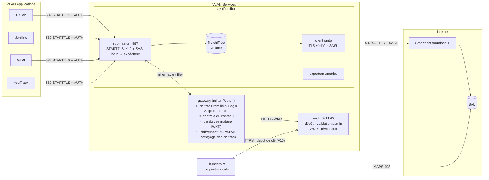

# Plan d'implémentation : relais SMTP applicatif chiffrant (OpenPGP)

> Statut : **validé le 2026-10-25 (toutes les décisions D1 à D12 acceptées)**. Implémentation lot par lot, un commit poussé par lot.
> Avancement : lots 0 à 3 terminés.
> Base : branche `claude/vigilant-mccarthy-kgzh0e` (relai Postfix, liste blanche IP,
> TLS + SASL vers le fournisseur, 19 tests d'intégration verts).
> Branche de travail : `claude/gallant-shannon-7yirrk`.
> Référence : PRD « Relais SMTP applicatif : proposition d'architecture ».

**Definition of done d'un lot** : tous les tests d'intégration et de bout en bout du
lot, plus ceux des lots précédents, passent avec `tests/run-tests.sh`. Les tests
utilisent de vrais logiciels (Postfix, Dovecot, GnuPG, RNP, HTTPS avec certificats
vérifiés) et aucun mock ni contournement.

---

## 0. Écarts entre l'existant et le PRD

| Exigence du PRD | Existant | À faire |
|---|---|---|
| Point d'entrée `smtp-relay:587`, STARTTLS, un identifiant par application | Port 25 en clair, sans authentification, liste blanche IP | Soumission 587, TLS ≥ 1.2 obligatoire, SASL par application, port 25 fermé |
| Anti-usurpation : identifiant lié à l'adresse expéditrice | Réécriture de tout expéditeur vers `noreply@` | Liaison login ↔ expéditeur (enveloppe + `From:`), refus sinon |
| Quotas horaires par application | Aucun | Moteur de politiques : quota glissant par application |
| Chiffrement OpenPGP pour le destinataire, objet neutre, échec fermé | Aucun | Passerelle de chiffrement avant mise en file |
| Annuaire de clés publiques (dépôt HTTPS, vérification admin, expiration, révocation) | Aucun | Service `keydir` |
| Contrôle du contenu sortant dès le départ | Aucun | Règles de contenu avant chiffrement |
| Suppression des en-têtes internes | Aucune | Liste blanche d'en-têtes extérieurs, pseudonymisation des identifiants |
| Supervision (file, refus, clés, auth, smarthost) | Healthcheck seul | Exporteur de métriques (F4) |
| Journaux réduits aux métadonnées, conservation configurable | Logs Postfix sur stdout | Vérification « aucune fuite de contenu », rotation et syslog TLS configurables |
| Tout est code : inventaire, CI, test post-déploiement | `.env` + tests locaux | Inventaire versionné, `.gitlab-ci.yml`, `relay-smoke-test` |
| TLS vérifié vers le smarthost, file persistante | **Fait** | Conservé et retesté |

---

## 1. Architecture cible

Conteneurs (une responsabilité chacun) :

| Conteneur | Image | Rôle |
|---|---|---|
| `relay` | `relay/` (existante, étendue) | Postfix : contrat 587, authentification, liaison expéditeur, file, sortie TLS. Exporteur de métriques. |
| `gateway` | `gateway/` (nouvelle) Python 3.14 + `python3-milter` + GnuPG | Moteur de politiques (quotas, contenu) et passerelle de chiffrement, appelés par Postfix **avant** l'écriture en file. |
| `keydir` | `keydir/` (nouvelle) Python 3.14 + GnuPG + SQLite | Annuaire de clés publiques : dépôt HTTPS, validation par un administrateur, publication WKD, révocations. |

Le message n'est jamais écrit en clair dans la file : le milter remplace le contenu
avant que Postfix l'accepte (`250 queued`). Si la passerelle ne répond pas,
`milter_default_action = tempfail` renvoie une erreur temporaire à l'application.

---

## 2. Décisions de conception (à valider)

| # | Décision | Recommandation |
|---|---|---|
| D1 | Liste blanche IP existante | **Conservée** en défense en profondeur, en plus du SASL (un identifiant volé ne sert pas hors du VLAN Applications). |
| D2 | Ruptures de compatibilité | **Port 25 supprimé** (F8) et **réécriture d'expéditeur supprimée** au profit de la liaison login ↔ adresse. Version 2.0.0. |
| D3 | Inventaire des applications | `config/applications.toml` (nom, adresse expéditrice, quota, IP) + un secret par application `secrets/apps/<nom>` (répertoire monté, pour qu'ajouter une application ne demande pas de modifier `docker-compose.yml`). Validé par `relay-config check`, utilisé aussi en CI. Ajouter une application = une entrée + un secret. |
| D4 | Format chiffré | PGP/MIME (RFC 3156) avec **en-têtes protégés** (`protected-headers="v1"`, lus par Thunderbird) : objet réel chiffré, objet extérieur neutre configurable. Un seul message chiffré pour tous les destinataires d'une transaction, identifiants de clés masqués (`--throw-keyids`) pour ne pas trahir les Cci. **Ajusté au lot 3** : identifiants masqués seulement pour un destinataire unique. Avec plusieurs destinataires, RNP 0.18 (la bibliothèque de Thunderbird) n'essaie que le premier destinataire masqué : les suivants ne pourraient pas déchiffrer (constaté en test). Les identifiants restent donc visibles dans ce cas, et un destinataire en Cci est détectable par les autres via l'identifiant de sa sous-clé. |
| D5 | Échec fermé | Destinataire sans clé valide (absente, expirée, révoquée, sans sous-clé de chiffrement) : `550 5.7.1` au `RCPT TO`, pour ce destinataire. Passerelle ou annuaire injoignable : `451 4.7.1` (l'application réessaie). Jamais d'envoi en clair. |
| D6 | Annuaire | Service léger `keydir` : dépôt HTTPS, validation admin par CLI (comparaison d'empreinte hors bande), publication **WKD** (standard lu par Thunderbird et GnuPG), certificat de révocation appliqué immédiatement, rotation = nouvelle clé validée qui remplace l'ancienne. La passerelle interroge le WKD de l'annuaire avec un cache (TTL configurable, 5 min par défaut). |
| D7 | Quotas | Messages par heure et par application, fenêtre glissante, compteurs SQLite persistants (survivent au redémarrage). Dépassement : `452 4.7.1` temporaire. |
| D8 | Contrôle du contenu | Règles versionnées (`config/content-rules.toml`) appliquées au texte **décodé** (parties MIME, pièces jointes base64, en-têtes) avant chiffrement : blocs de clé privée, jetons connus (`glpat-`, AWS, etc.), extensions interdites, taille. Refus `550 5.7.1` avec l'identifiant de règle (jamais le contenu) dans le log. |
| D9 | En-têtes extérieurs | Liste blanche (From, To, Cc, Date, Subject neutre, MIME, Message-ID, In-Reply-To, References, Reply-To, Auto-Submitted). Tout le reste (`X-GitLab-*`, `X-Jenkins-*`, `Received` internes, `X-Mailer`…) passe dans la partie chiffrée. `Message-ID`, `In-Reply-To` et `References` sont pseudonymisés par HMAC (`<hash@domaine>`) : plus de nom d'hôte interne, et le regroupement en fils dans Thunderbird est conservé. Le `Received` ajouté par le relai est retiré en sortie. |
| D10 | Test de bout en bout | Fournisseur simulé avec de **vrais logiciels** : Postfix (soumission 587, TLS + SASL) et Dovecot (BAL, IMAPS 993). Côté « Thunderbird », un conteneur poste de travail génère sa paire de clés, la dépose sur l'annuaire, rapatrie le message en IMAPS (certificat vérifié) et le déchiffre avec **RNP**, la bibliothèque OpenPGP de Thunderbird. Le chiffrement (GnuPG) et le déchiffrement (RNP) passent donc par deux implémentations différentes. Thunderbird lui-même (interface graphique) n'est pas piloté : une vérification manuelle est prévue dans la recette. |
| D11 | Journaux et RGPD | Aucune donnée de contenu dans les journaux (un test le vérifie sur tous les conteneurs). Pas de journal persistant sur le relai ; rotation Docker et export syslog TLS (F5) configurables ; durée de conservation des journaux d'audit de l'annuaire configurable (`KEYDIR_AUDIT_RETENTION_DAYS`). |
| D12 | Hors périmètre du code (documentation seulement) | Règles de pare-feu périmétrique (F7, F9), chiffrement du disque, coffre-fort (les secrets restent des fichiers Docker secrets alimentés depuis le coffre), DNS SPF/DKIM/DMARC, DKIM du smarthost, haute disponibilité, séquestre des clés. |

---

## 3. Lots et definition of done

Chaque lot se termine par un commit poussé sur la branche, avec la suite complète
verte. Les modules Python purs ont aussi des tests unitaires (`unittest`) ; ils
complètent les tests d'intégration sans les remplacer.

### Lot 0 : socle de test et CI

- Réorganisation : `tests/run-tests.sh` (orchestrateur, sélection `SUITES=`),
  `tests/lib.sh` (fonctions communes), `tests/suites/NN-*.sh` (une suite par lot).
- `test/provider/` remplace `test/fake-mta/` : Postfix (587, TLS + SASL obligatoires)
  qui livre en LMTP à Dovecot (BAL `alice@`, `bob@`, `carol@` du domaine, `ext@partner.test`).
- `test/workstation/` : RNP, GnuPG, curl, Python (imaplib) ; simule un poste Thunderbird.
- PKI de test étendue : certificats `smtp-relay`, `keydir`, `provider`.
- `.gitlab-ci.yml` : lint (shellcheck, compilation Python, tests unitaires),
  `relay-config check`, construction des images, tests d'intégration.

DoD : les scénarios existants encore valables restent verts (TLS vérifié + SASL
vers le fournisseur, file `deferred` persistante après redémarrage, refus de
démarrage sur configuration invalide, healthcheck) et un message livré est relu
en IMAPS dans la BAL Dovecot.

### Lot 1 : contrat d'entrée 587 + identité par application

- Postfix : service `submission` 587 seul, `smtpd_tls_security_level = encrypt`,
  TLS ≥ 1.2, `smtpd_tls_auth_only`, SASL Cyrus (sasldb générée en tmpfs depuis
  l'inventaire et les secrets), `smtpd_sender_login_maps` +
  `reject_sender_login_mismatch`, limitation des tentatives d'authentification (anvil).
- Inventaire `config/applications.toml` + `relay-config check`.
- Passerelle (squelette) : contrôle que l'en-tête `From:` correspond à l'adresse du login,
  et que le login n'est utilisé que depuis les IP déclarées pour l'application.

| Test | Attendu |
|---|---|
| IT1.1 | GitLab, Jenkins, GLPI, YouTrack s'authentifient en STARTTLS (certificat vérifié) : chaque message arrive dans la BAL (lu en IMAPS) |
| IT1.2 | Sans STARTTLS : AUTH non proposé, envoi refusé (`530 5.7.0`) |
| IT1.3 | Client limité à TLS 1.1 : poignée de main refusée ; TLS 1.2 et 1.3 acceptés |
| IT1.4 | Mauvais mot de passe : `535`, échec journalisé (login, IP), rien n'est livré |
| IT1.5 | Sans authentification : refusé |
| IT1.6 | Login `gitlab` avec `MAIL FROM:<jenkins@…>` : `553 5.7.1` ; enveloppe correcte mais `From:` usurpé : `550 5.7.1` |
| IT1.7 | Port 25 du relai : connexion refusée |
| IT1.8 | Identifiants valides depuis une IP hors liste blanche, ou depuis l'IP d'une autre application : refusé |
| IT1.9 | Inventaire invalide (adresse en double, secret absent, adresse hors domaine, quota invalide) : démarrage refusé avec message `FATAL` |
| IT1.10 | Ajout d'une application (entrée + secret) puis redémarrage : la nouvelle application envoie, les autres ne sont pas affectées |

### Lot 2 : annuaire de clés publiques (`keydir`)

- HTTPS (TLS ≥ 1.2) : `POST /api/v1/keys` (dépôt), `GET /.well-known/openpgpkey/…` (WKD),
  `GET /api/v1/keys/<email>` (état).
- CLI d'administration : `list`, `show`, `approve`, `reject`, `revoke`, `remove`.
- Contrôles au dépôt : clé lisible, UID e-mail cohérent, non expirée, sous-clé de
  chiffrement présente, algorithmes acceptés (RSA ≥ 3072, Ed25519/Cv25519).
- Journal d'audit des actions (métadonnées seulement), conservation configurable.

| Test | Attendu |
|---|---|
| IT2.1 | Le poste génère sa clé (RNP) et la dépose en HTTPS (certificat vérifié) : état « en attente », absente du WKD (404) |
| IT2.2 | Validation par l'administrateur : le WKD sert la clé, empreinte identique à celle du poste |
| IT2.3 | Dépôts refusés : sans sous-clé de chiffrement, expirée, RSA 1024, UID différent, contenu invalide |
| IT2.4 | Rotation : nouvelle clé déposée et validée, le WKD ne sert plus que la nouvelle |
| IT2.5 | Dépôt d'un certificat de révocation : appliqué immédiatement, sans validation |
| IT2.6 | HTTP en clair et TLS < 1.2 refusés |
| IT2.7 | État conservé après redémarrage |

### Lot 3 : passerelle de chiffrement (cœur)

- `RCPT TO` : recherche de la clé (WKD + cache), contrôle de validité, refus sinon.
- Fin de message : partie interne MIME avec en-têtes protégés, chiffrement GnuPG
  pour tous les destinataires, remplacement du corps et des en-têtes, objet neutre.
- Postfix : `smtpd_milters`, `milter_default_action = tempfail`, délais.

| Test | Attendu |
|---|---|
| IT3.1 | **E2E** GitLab → alice : le message brut dans la BAL est `multipart/encrypted`, objet neutre, aucun fragment du texte d'origine ; déchiffré par RNP avec la clé d'alice : corps, objet réel et pièces jointes identiques (SHA-256) |
| IT3.2 | La clé de bob ne déchiffre pas le message d'alice |
| IT3.3 | carol (sans clé) : `550 5.7.1` au `RCPT TO`, rien en file ni en BAL |
| IT3.4 | alice + carol : carol refusée, alice livrée chiffrée |
| IT3.5 | alice + bob : un seul message, déchiffrable par chacun ; identifiants de clés masqués pour un destinataire unique, visibles à plusieurs (voir D4) |
| IT3.6 | Clé expirée ou révoquée (lot 2) : refus après expiration du cache |
| IT3.7 | Passerelle arrêtée : erreur temporaire (Postfix répond `454 4.3.0`), rien de livré ; passerelle relancée : le renvoi réussit |
| IT3.8 | Annuaire arrêté, cache vide : `451`, rien de livré |
| IT3.9 | Après rotation, le message suivant n'est déchiffrable qu'avec la nouvelle clé |
| IT3.10 | Destinataire externe avec clé validée : livré chiffré ; sans clé : refusé |
| IT3.11 | Fournisseur arrêté, message en file : le fichier de file (`postcat`) ne contient que du chiffré |
| IT3.12 | Objet UTF-8 (RFC 2047), pièces jointes binaires et message proche de la taille maximale : aller-retour exact |

### Lot 4 : nettoyage des en-têtes

| Test | Attendu |
|---|---|
| IT4.1 | En-têtes extérieurs du message en BAL ⊆ liste blanche ; aucune IP `10.0.x.x`, aucun nom d'hôte interne, aucun `X-GitLab-*` ; ces en-têtes sont présents dans la partie déchiffrée |
| IT4.2 | Deux notifications du même fil : `References` pseudonymisés identiques, fil conservé |
| IT4.3 | Aucun `Received` ne révèle la topologie interne |

### Lot 5 : quotas

| Test | Attendu |
|---|---|
| IT5.1 | Quota GLPI de test = 5 : 5 messages acceptés, le 6e reçoit `452 4.7.1` ; Jenkins n'est pas affecté |
| IT5.2 | Compteur conservé après redémarrage de la passerelle |
| IT5.3 | Fenêtre de test courte : envoi de nouveau accepté après son expiration |

### Lot 6 : contrôle du contenu sortant

| Test | Attendu |
|---|---|
| IT6.1 | Bloc `-----BEGIN … PRIVATE KEY-----` dans le corps : `550 5.7.1` + identifiant de règle, rien de livré, log sans contenu |
| IT6.2 | Jeton dans une pièce jointe encodée en base64 : détecté après décodage, refusé |
| IT6.3 | Pièce jointe `.exe` : refusée |
| IT6.4 | Message sain : livré ; fichier de règles invalide : démarrage refusé |

### Lot 7 : supervision et RGPD

- Exporteur Prometheus (F4) : taille de file et âge du plus ancien message, différés
  et rejets par application et par motif, refus faute de clé par destinataire,
  échecs d'authentification, dépassements de quota, blocages de contenu, clés
  proches de l'expiration ou révoquées, joignabilité et expiration du certificat
  du smarthost.

| Test | Attendu |
|---|---|
| IT7.1 | Après un refus faute de clé, un échec d'authentification, un dépassement de quota : les compteurs correspondants augmentent |
| IT7.2 | Fournisseur arrêté : taille de file ≥ 1, âge du plus ancien > 0 |
| IT7.3 | Date d'expiration du certificat du smarthost = celle du certificat de test |
| IT7.4 | Clé expirant dans 10 jours : signalée « proche de l'expiration » |
| IT7.5 | Aucun objet ni corps de message de test dans les journaux d'aucun conteneur |

### Lot 8 : exploitation et documentation

- `.gitlab-ci.yml` finalisé ; `relay-smoke-test` (test post-déploiement : message
  de contrôle vers une BAL de supervision, vérification de l'acceptation par le smarthost).
- Documentation : README, architecture (5 zones, flux F1 à F10), mise en production
  (annuaire, procédure de vérification des clés, configuration de Thunderbird,
  pare-feu), exploitation (ajout d'application, rotation des secrets, clés).

| Test | Attendu |
|---|---|
| IT8.1 | `relay-smoke-test` réussit sur la stack de test et échoue (code ≠ 0) quand le fournisseur est arrêté |

---

## 4. Risques identifiés

| Risque | Parade |
|---|---|
| Affichage des en-têtes protégés dans Thunderbird | Structure MIME conforme à celle produite par Thunderbird ; vérification manuelle dans Thunderbird pendant la recette |
| Destinataires masqués et RNP | RNP 0.18 n'essaie que le premier destinataire masqué : identifiants masqués réservés aux messages à destinataire unique (D4). Recette : vérifier dans Thunderbird le déchiffrement d'un message à destinataire unique (identifiant masqué) et d'un message à plusieurs destinataires |
| Taille du message chiffré | L'armure ASCII grossit le message : `cleanup` accepte 1,5 × `MESSAGE_SIZE_LIMIT` (la limite annoncée aux applications reste `MESSAGE_SIZE_LIMIT`) ; la limite du fournisseur doit être au moins égale à 1,5 × `MESSAGE_SIZE_LIMIT` |
| Robustesse de `python3-milter` | Paquet Ubuntu maintenu ; repli possible sur `smtpd_proxy_filter` (même passerelle, autre transport) |
| Lecture des logs Postfix par l'exporteur | Prototype dès le lot 7 (FIFO ou fichier tmpfs relu) avant d'en dépendre |
| Limite de débit Docker Hub pendant les constructions | Images de base mises en cache, nouvelles tentatives |
